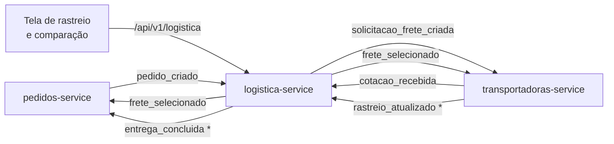

# Logística e Transporte | Portal B2B Distribuído

Microsserviços de **Logística** e **Transportadoras** do Portal B2B Distribuído, trabalho da disciplina de Sistemas Distribuídos (2026). O grupo cuida do que acontece depois que o pedido é criado: cotar o frete com as transportadoras, comparar as propostas, escolher a vencedora e acompanhar a entrega num mapa até a chegada.

> **Situação:** fase de planejamento. Ainda não há código. Este repositório reúne o contexto, a arquitetura proposta e as decisões que o grupo precisa tomar. **Para a reunião, comece pela [Pauta de decisões](docs/06-pauta-de-decisoes.md).**

## Integrantes

Conforme o guia do kit de infraestrutura (confirmar):

- Gabriel Borges
- Pedro Blamires
- Gabriel Rodrigues
- Heitor Deodato
- Jefferson Felex

## O que o grupo entrega

| Serviço | Porta | Schema | Papel |
|---|:---:|---|---|
| `logistica-service` | 8108 | `logistica` | Abre a solicitação de frete quando um pedido é criado, recebe as cotações, compara, seleciona o frete e mantém a entrega e o rastreio |
| `transportadoras-service` | 8109 | `transportadoras` | Cadastro das transportadoras homologadas, cálculo das cotações (simuladas ou enviadas pela transportadora), simulação da viagem e indicadores de desempenho |

Porta, schema, usuário de banco e tópicos já foram definidos pelo [kit de infraestrutura](https://github.com/Printf-PedroCardoso/portal-b2b-kit-infra). O trabalho tem três frentes:

| Frente | Origem | Situação no kit |
|---|---|---|
| **1. Cotação e seleção de frete** | Kit (seção 8 do guia) | Tópicos e regra definidos (menor preço, desempate por menor prazo, janela de 10 s). Boilerplate incompleto |
| **2. Comparação entre transportadoras** | Pedido do professor | Não existe. O kit só tem 2 transportadoras com preço fixo |
| **3. Rastreio visual da entrega** | Pedido do professor | Não existe. Não há tópico de entrega nem de rastreio, e nenhum serviço leva o pedido a `ENTREGUE` por evento |

## Fluxo resumido



`*` tópicos novos, que precisam ser propostos ao grupo de Infraestrutura. Todas as setas entre serviços passam pelo Redpanda. O detalhe está em [Arquitetura proposta](docs/02-arquitetura-proposta.md).

## Documentação

| Documento | Conteúdo |
|---|---|
| [01. Contexto e escopo](docs/01-contexto-e-escopo.md) | O Portal B2B, o que o kit já define para o grupo, o que o professor acrescentou e o que fica fora |
| [02. Arquitetura proposta](docs/02-arquitetura-proposta.md) | Responsabilidades, fluxo completo, estados, comparação, rastreio visual, modelo de dados e API |
| [03. Eventos e integrações](docs/03-eventos-e-integracoes.md) | Payloads propostos, tópicos novos e o que precisamos pedir a cada grupo |
| [04. Análise do kit](docs/04-analise-do-kit.md) | Problemas encontrados nos boilerplates de logística e transportadoras |
| [05. Plano de trabalho](docs/05-plano-de-trabalho.md) | Fases, entregáveis, divisão de frentes e roteiro da demonstração |
| [06. Pauta de decisões](docs/06-pauta-de-decisoes.md) | Decisões em aberto, com opções e recomendação, e perguntas para o professor |

## Repositórios de referência

| Repositório | Grupo | Uso aqui |
|---|---|---|
| [portal-b2b-kit-infra](https://github.com/Printf-PedroCardoso/portal-b2b-kit-infra) | Infraestrutura | Base: portas, schemas, tópicos, envelope de eventos, boilerplates e regra de seleção de frete (commit `630515c`) |
| [Sistema-MicServ-SD](https://github.com/davicalvarenga/Sistema-MicServ-SD) | Fornecimento e Produtos | Modelo de organização da documentação e análise do kit (itens K1 a K11). Têm pendências abertas com o nosso grupo (P-06, P-27) |
| [portal-b2b-UI-UX](https://github.com/HugoParzival007/portal-b2b-UI-UX) | UX/UI | Mockups das telas de fretes e de rastreamento, que a nossa API precisa alimentar |
| [AED---Processo-e-Artefato-SD-](https://github.com/AmandaBfa/AED---Processo-e-Artefato-SD-) | Teste e Qualidade | Modelo ERS-LLM para as especificações dos serviços, que o QA usa para testar |

## Como subir o ambiente

O ambiente local vem do kit. É preciso ter Docker e Docker Compose.

```bash
git clone https://github.com/Printf-PedroCardoso/portal-b2b-kit-infra
cd portal-b2b-kit-infra
make env        # copia .env.example para .env
make infra-up   # PostgreSQL, Redpanda, gateway, PgAdmin e Kafka UI
```

| Ferramenta | Endereço |
|---|---|
| Gateway (APIs e front-ends) | http://localhost:8080 |
| Kafka UI | http://localhost:8090 |
| PgAdmin | http://localhost:5050 |
| Redpanda (clientes Kafka) | localhost:19092 |
| PostgreSQL | localhost:5432 |

As instruções para rodar os nossos serviços entram aqui quando o primeiro estiver implementado. Antes disso, veja a [Análise do kit](docs/04-analise-do-kit.md): os boilerplates não consomem Kafka e não gravam no banco.

## Estrutura do repositório

```
.
├── README.md
├── CLAUDE.md                     # orientações para o Claude Code
├── docs/
│   ├── 01-contexto-e-escopo.md
│   ├── 02-arquitetura-proposta.md
│   ├── 03-eventos-e-integracoes.md
│   ├── 04-analise-do-kit.md
│   ├── 05-plano-de-trabalho.md
│   └── 06-pauta-de-decisoes.md
└── services/
    ├── logistica-service/        # ainda sem código
    └── transportadoras-service/  # ainda sem código
```
