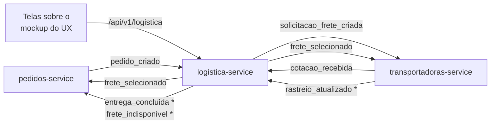

# Logística e Transporte | Portal B2B Distribuído

Microsserviços de **Logística** e **Transportadoras** do Portal B2B Distribuído, trabalho da disciplina de Sistemas Distribuídos (2026). O grupo cuida do que acontece depois que o pedido é criado: cotar o frete com as transportadoras, comparar as propostas, escolher a vencedora e acompanhar a entrega num mapa até a chegada.

> **Situação:** etapa 1 concluída e validada no Docker: um pedido entra e o frete é escolhido sozinho, com idempotência, DLT e duas cópias de cada serviço. Pendente com outros grupos: enviar a [proposta de contrato](docs/contratos/proposta-grupo-pedidos.md) ao grupo de Pedidos. **Decisões em [Pauta de decisões](docs/06-pauta-de-decisoes.md); explicações do código em [`docs/explicacoes/`](docs/explicacoes/).**

## Integrantes

Conforme o guia do kit de infraestrutura (confirmar):

- Gabriel Borges
- Pedro Blamires
- Gabriel Rodrigues
- Heitor Deodato
- Jefferson Felex

## O que o grupo entrega

| Serviço | Porta | Schema | Papel |
|---|:---:|---|---|
| `logistica-service` | 8108 | `logistica` | Abre a solicitação de frete, recebe as cotações, mostra a comparação, registra a escolha do comprador (ou aplica a regra automática), mantém a entrega e o rastreio, notifica e controla o relógio do módulo |
| `transportadoras-service` | 8109 | `transportadoras` | Transportadoras, motoristas e veículos; cotações simuladas e digitadas; escala do motorista; simulação da viagem e indicadores de desempenho |

Porta, schema, usuário de banco e tópicos já foram definidos pelo [kit de infraestrutura](https://github.com/Printf-PedroCardoso/portal-b2b-kit-infra). O trabalho tem três frentes:

| Frente | Origem | Situação no kit |
|---|---|---|
| **1. Cotação e seleção de frete** | Kit (seção 8 do guia) | Tópicos e regra definidos (menor preço, desempate por menor prazo, janela de 10 s). Boilerplate incompleto |
| **2. Comparação entre transportadoras** | Pedido do professor | Não existe. O kit só tem 2 transportadoras com preço fixo |
| **3. Rastreio visual da entrega** | Pedido do professor | Não existe. Não há tópico de entrega nem de rastreio, e nenhum serviço leva o pedido a `ENTREGUE` por evento |

## Fluxo resumido



`*` tópicos novos, que precisam ser propostos ao grupo de Infraestrutura. Todas as setas entre serviços passam pelo Redpanda. O detalhe está em [Arquitetura](docs/02-arquitetura-proposta.md).

## Documentação

| Documento | Conteúdo |
|---|---|
| [01. Contexto e escopo](docs/01-contexto-e-escopo.md) | O Portal B2B, o que o kit já define para o grupo, o que o professor acrescentou e o que fica fora |
| [02. Arquitetura](docs/02-arquitetura-proposta.md) | Responsabilidades, fluxo, estados, escolha do frete, rastreio, relógio, notificações, modelo de dados, API e pontos de sistemas distribuídos |
| [03. Eventos e integrações](docs/03-eventos-e-integracoes.md) | Payloads, tópicos novos e o que precisamos pedir a cada grupo |
| [04. Análise do kit](docs/04-analise-do-kit.md) | Problemas encontrados nos boilerplates de logística e transportadoras |
| [05. Plano de trabalho](docs/05-plano-de-trabalho.md) | Etapas, testes e roteiro da demonstração |
| [06. Pauta de decisões](docs/06-pauta-de-decisoes.md) | Decisões D1 a D24 e perguntas para o professor |
| [Proposta ao grupo de Pedidos](docs/contratos/proposta-grupo-pedidos.md) | Documento pronto para enviar: campos do `pedido_criado` e eventos que eles precisam consumir |

## Repositórios de referência

| Repositório | Grupo | Uso aqui |
|---|---|---|
| [portal-b2b-kit-infra](https://github.com/Printf-PedroCardoso/portal-b2b-kit-infra) | Infraestrutura | Base: portas, schemas, tópicos, envelope de eventos, boilerplates e regra de seleção de frete (commit `630515c`) |
| [Sistema-MicServ-SD](https://github.com/davicalvarenga/Sistema-MicServ-SD) | Fornecimento e Produtos | Modelo de organização da documentação e análise do kit (itens K1 a K11). Têm pendências abertas com o nosso grupo (P-06, P-27) |
| [portal-b2b-UI-UX](https://github.com/HugoParzival007/portal-b2b-UI-UX) | UX/UI | Mockups das telas de fretes e de rastreamento, que a nossa API precisa alimentar |
| [AED---Processo-e-Artefato-SD-](https://github.com/AmandaBfa/AED---Processo-e-Artefato-SD-) | Teste e Qualidade | Modelo ERS-LLM para as especificações dos serviços, que o QA usa para testar |

## Como rodar

O repositório tem um ambiente de desenvolvimento próprio (`docker-compose.yml`): Postgres, Redpanda, Redpanda Console e as **duas cópias** de cada serviço, como no kit. As portas não conflitam com as do kit. É preciso ter o Docker Desktop aberto.

```bash
cp .env.example .env               # opcional: troque as senhas
docker compose up -d --build       # sobe tudo
docker compose ps                  # aguarde tudo ficar healthy/running

# publica um pedido falso (Sorriso/MT → Santos/SP, 24 t de soja)
docker compose exec logistica-1 python -m comum.ferramentas.publicar_pedido_falso

docker compose logs -f logistica-1 transportadoras-1
docker compose down -v             # derruba e apaga os dados
```

| Ferramenta | Endereço |
|---|---|
| Logística (cópias 1 e 2) | http://localhost:8108/docs e http://localhost:8118/docs |
| Transportadoras (cópias 1 e 2) | http://localhost:8109/docs e http://localhost:8119/docs |
| Redpanda Console (mensagens) | http://localhost:8091 |
| Redpanda (clientes Kafka) | localhost:29092 |
| PostgreSQL | localhost:15432 (banco `portal_b2b`) |

Token para chamar a API: `docker compose exec logistica-1 python -m comum.ferramentas.gerar_token --perfil admin`.

Testes unitários, sem Docker:

```bash
python -m venv .venv
.venv/Scripts/python -m pip install -e "comum[testes]"    # Linux/Mac: .venv/bin/python
.venv/Scripts/python -m pytest
```

O que já funciona e como cada parte foi feita está em [`docs/explicacoes/`](docs/explicacoes/).

## Estrutura do repositório

```
.
├── README.md
├── CLAUDE.md                     # orientações para o Claude Code
├── docker-compose.yml            # ambiente de desenvolvimento
├── comum/                        # código compartilhado pelos dois serviços
│   ├── comum/                    # eventos, outbox, consumidor, relógio, JWT, erros, logs
│   │   ├── contratos/            # JSON Schemas dos eventos
│   │   └── ferramentas/          # pedido falso (D23) e gerador de token
│   └── tests/
├── services/
│   ├── logistica-service/
│   │   ├── logistica/            # código do serviço
│   │   ├── migracoes/            # tabelas do schema logistica
│   │   └── tests/
│   └── transportadoras-service/
│       ├── transportadoras/
│       ├── migracoes/
│       └── tests/
├── infra/                        # inicialização do Postgres e dos tópicos
└── docs/
    ├── 01-contexto-e-escopo.md ... 06-pauta-de-decisoes.md
    ├── contratos/                # propostas de contrato com outros grupos
    └── explicacoes/              # explicação de cada parte implementada
```
