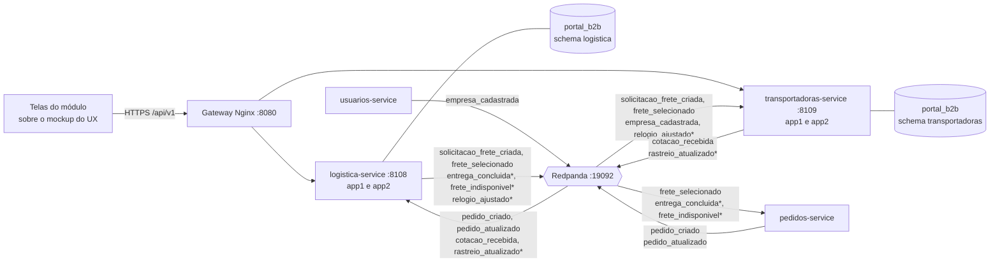
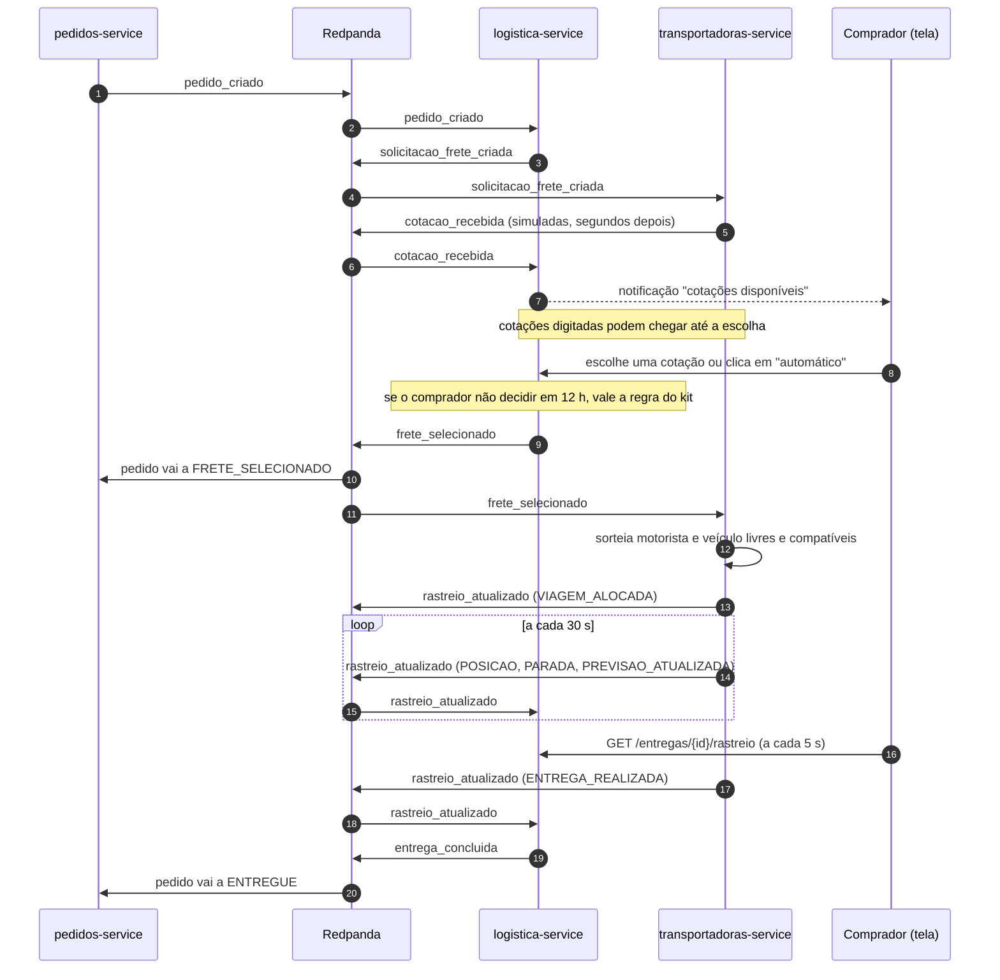
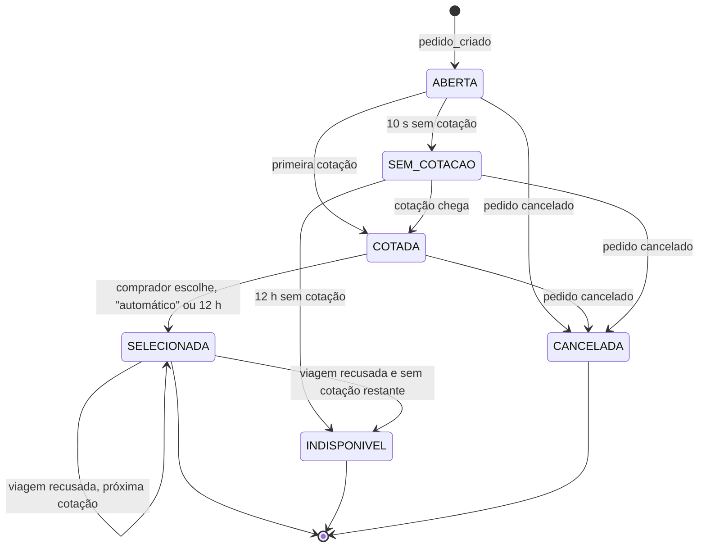
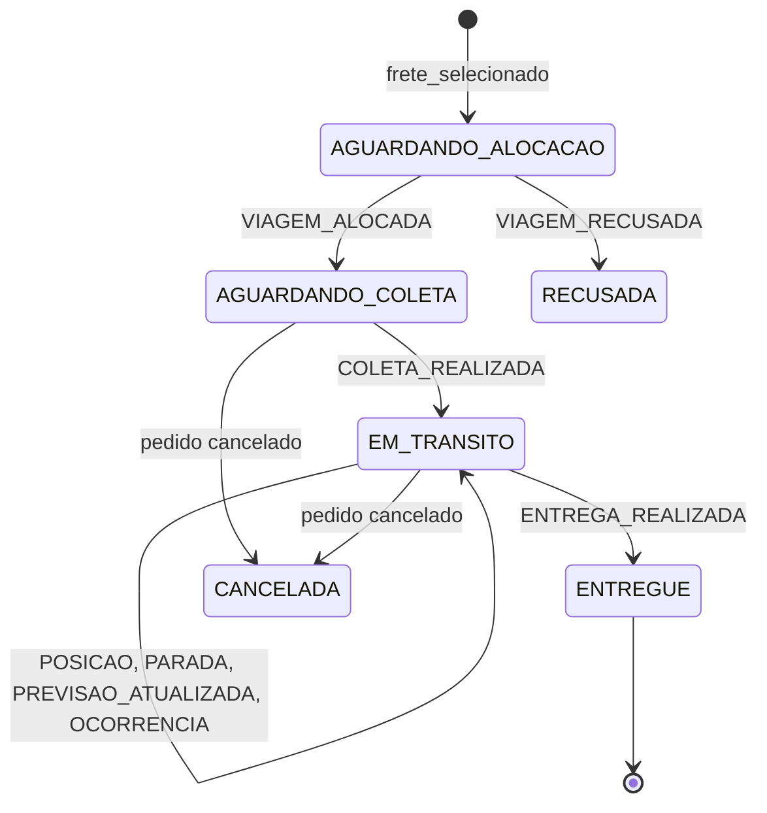

# 02. Arquitetura

Arquitetura dos dois serviços conforme as decisões da [pauta](06-pauta-de-decisoes.md) (D1 a D24). O que ainda depende de aprovação externa está marcado como **proposta**: os tópicos novos (Infra) e os campos novos do `pedido_criado` (grupo de Pedidos).

## 1. Visão geral

Os **dois serviços do kit** (D1). O `logistica-service` é dono da solicitação de frete, da escolha, da entrega, do rastreio, das notificações e do relógio do módulo. O `transportadoras-service` é dono das transportadoras, dos motoristas e veículos, das cotações e da viagem, porque no mundo real é a transportadora quem cota, escala o motorista e informa onde o caminhão está.



`*` tópicos novos, a propor à Infraestrutura (D12, D18). O `transportadoras-service` consumir `frete_selecionado` também é novidade: no catálogo do kit só o `pedidos-service` consome esse tópico.

## 2. Responsabilidades

### 2.1 `logistica-service` (8108)

| Responsabilidade | Entrada | Saída |
|---|---|---|
| Abrir solicitação de frete | Consome `pedido_criado` | Grava a solicitação (origem, destino, carga, peso, produto, valor) com os prazos de D4. Publica `solicitacao_frete_criada` |
| Receber cotações | Consome `cotacao_recebida` | Grava a cotação se o frete ainda não foi escolhido. Avisa o comprador da primeira cotação |
| Controlar os prazos | Rotina periódica (D14) | Rodada de 10 s vencida sem cotação → `SEM_COTACAO` e aviso. Prazo de 12 h vencido → escolha automática ou frete indisponível |
| Comparar cotações | `GET` da comparação | Cotações lado a lado, selos, gráfico e pontualidade de cada transportadora (D6) |
| Escolher o frete | Comprador escolhe ou clica em "automático" (D5); ou prazo vence | Marca a vencedora, cria a entrega e publica `frete_selecionado` |
| Trocar de transportadora | `rastreio_atualizado` do tipo `VIAGEM_RECUSADA` (D20) | Escolhe a próxima cotação pela regra do kit e publica outro `frete_selecionado`. Sem cotação restante → `frete_indisponivel` |
| Manter a entrega e o rastreio | Consome `rastreio_atualizado` | Motorista, veículo, posição, progresso, previsão e linha do tempo |
| Concluir a entrega | Rastreio `ENTREGA_REALIZADA` | Publica `entrega_concluida` e atualiza a pontualidade da transportadora |
| Cancelar | Consome `pedido_atualizado` com `CANCELADO` | Cancela a solicitação ou a entrega |
| Notificar | Mudanças acima | Notificações para comprador e fornecedor (D22) |
| Gerar documentos | `GET` do documento | Modelos demonstrativos com os dados da entrega (D21) |
| Relógio do módulo | Administrador | Grava o novo ritmo e publica `relogio_ajustado` (D18) |

### 2.2 `transportadoras-service` (8109)

| Responsabilidade | Entrada | Saída |
|---|---|---|
| Cadastrar transportadoras | Consome `empresa_cadastrada` (tipo transportadora); perfil operacional pela API | Tipos de carga, UFs atendidas, tabela de preços |
| Cadastrar motoristas e veículos | API, perfil `transportadora` (D19) | Motoristas (nome, telefone, CNH) e veículos (placa, tipo, capacidade, tipos de carga) |
| Cotar automaticamente | Consome `solicitacao_frete_criada` | Para cada transportadora compatível **e com motorista e veículo livres** (D20), calcula preço e prazo e publica `cotacao_recebida` |
| Receber cotação digitada | `POST` do usuário `transportadora` | Mesma checagem de disponibilidade; publica `cotacao_recebida` |
| Listar cargas disponíveis | Cópia local das solicitações | Tela "Solicitações de frete" |
| Escalar motorista e veículo | Consome `frete_selecionado` da sua transportadora | Sorteia entre os livres e compatíveis e publica `VIAGEM_ALOCADA`. Se não houver, publica `VIAGEM_RECUSADA` |
| Cancelar a viagem | Consome `pedido_atualizado` com `CANCELADO` | Encerra a viagem e libera motorista e veículo |
| Simular a viagem | Rotina a cada 30 s (D10) | Publica `rastreio_atualizado` com posição, progresso e previsão |
| Indicadores | Resultado das viagens | Entregas, % no prazo e atraso médio por transportadora e tipo de carga |
| Relógio do módulo | Consome `relogio_ajustado` | Usa o mesmo relógio da logística |

## 3. Fluxo ponta a ponta



Caminhos alternativos:

| Situação | O que acontece |
|---|---|
| Nenhuma cotação na rodada de 10 s | Solicitação vai a `SEM_COTACAO`; comprador e fornecedor são avisados. Continua aceitando cotações |
| Nenhuma cotação em 12 h | Logística publica `frete_indisponivel`; o grupo de Pedidos cancela o pedido |
| Transportadora vencedora sem motorista ou veículo livre | `VIAGEM_RECUSADA`; a logística passa para a próxima cotação e avisa o comprador. Sem cotação restante → `frete_indisponivel` |
| Pedido cancelado | `pedido_atualizado` com `CANCELADO`; a logística cancela a solicitação ou a entrega e a transportadora libera motorista e veículo |

Ponto em aberto com o grupo de Pedidos: quem move o pedido de `CRIADO` para `AGUARDANDO_FRETE`. Sugestão no [contrato](contratos/proposta-grupo-pedidos.md).

## 4. Estados

### 4.1 Solicitação de frete



O kit prevê só `ABERTA`, `COTADA` e `SELECIONADA`.

### 4.2 Entrega



Uma entrega `RECUSADA` fica no histórico; a próxima cotação gera uma entrega nova para o mesmo pedido (campo `tentativa`). `PARADA`, `PREVISAO_ATUALIZADA` e `OCORRENCIA` são eventos da linha do tempo, não estados.

## 5. Comparação e escolha do frete

### 5.1 Comparação das cotações (D6)

| Indicador | Origem |
|---|---|
| Preço total e preço por t·km | Cotação e solicitação |
| Prazo em dias úteis e data prevista de entrega | Cotação |
| Validade da proposta e observações | Cotação |
| Simulada ou digitada | Cotação |
| % de entregas no prazo, atraso médio, nº de entregas | Cópia local dos indicadores (seção 9.3) |
| Selos: "mais barata", "mais rápida", "mais pontual", "recomendada pela regra" | Calculados na consulta |

A tela mostra ainda um **gráfico preço × prazo**. Com uma cotação só, a comparação mostra só ela, com aviso.

### 5.2 Regra automática

Usada no botão "automático" e quando o prazo de 12 h vence (D5):

1. menor preço;
2. menor prazo em dias úteis (desempate do kit);
3. maior % de entregas no prazo;
4. `transportadoraId` em ordem alfabética, para o resultado ser sempre o mesmo.

### 5.3 Ranking

Por transportadora e tipo de carga: entregas feitas, % no prazo, atraso médio, preço médio por t·km e quantas vezes venceu. Os números vêm das viagens simuladas.

### 5.4 Motor de cotação simulada

```
distancia_km = haversine(origem, destino) × 1,3        (fator de sinuosidade da estrada)
preco        = max(preco_minimo, (tarifa_km × distancia_km + tarifa_ton × peso_t) × fator_tipo_carga)
prazo_dias   = prazo_base_dias + ceil(distancia_km / km_por_dia)
```

Exemplo: Sorriso (MT) a Santos (SP), o cenário dos mockups, dá cerca de 1.609 km em linha reta e **≈ 2.090 km** com o fator 1,3.

| Perfil | Tipos de carga | Característica |
|---|---|---|
| Expressa | `CARGA_SECA`, `GRANEL` | Cara e rápida, pontual |
| Econômica | `CARGA_SECA`, `GRANEL` | Barata e lenta, atrasa com frequência |
| Graneleira regional | `GRANEL` | Preço médio, atende só MT, GO, MS, SP e PR |
| Refrigerada | `REFRIGERADO` | Única que leva carga refrigerada |
| Perigosos | `PERIGOSO` | Única habilitada para carga perigosa |

Cada transportadora tem uma **probabilidade de atraso**, usada pelo simulador, e é isso que alimenta o ranking. Nomes fictícios. O cálculo é determinístico: qualquer variação usa uma semente derivada do `solicitacaoFreteId`.

Uma transportadora só cota se tiver **motorista e veículo livres e compatíveis** (D20). A checagem não reserva nada; a reserva acontece na escala (seção 6.2).

## 6. Rastreio visual

### 6.1 Cadastro de motoristas e veículos (D19)

| Cadastro | Campos |
|---|---|
| Motorista | nome, telefone, número e categoria da CNH, validade da CNH, ativo |
| Veículo | placa, tipo (`CARRETA_GRANELEIRA`, `BAU`, `REFRIGERADO`, `TANQUE`...), capacidade em kg, tipos de carga atendidos, ativo |

A tela segue o estilo do mockup do UX.

### 6.2 Escala do motorista e do veículo

Quando o `transportadoras-service` recebe um `frete_selecionado` de uma das suas transportadoras:

1. Filtra os motoristas e veículos **da transportadora**, **ativos**, **livres** (sem viagem em andamento), com **tipo de carga compatível**, **capacidade ≥ peso**, CNH válida e **categoria da CNH** suficiente para o veículo (C para caminhão, E para carreta).
2. **Sorteia** a ordem dos candidatos, com o id da entrega como semente: a mesma entrega gera sempre o mesmo sorteio.
3. Tenta **reservar** cada candidato com uma gravação condicional: `UPDATE ... SET viagem_atual_id = <viagem> WHERE id = <veículo> AND viagem_atual_id IS NULL`. Se outra viagem, na outra cópia do serviço, pegou o mesmo caminhão um instante antes, a gravação altera 0 linhas e o próximo do sorteio é tentado. Assim o mesmo caminhão nunca fica em duas viagens, e uma viagem não bloqueia a frota inteira enquanto escala.
4. Publica `VIAGEM_ALOCADA` com motorista, veículo, contato da transportadora e a rota. Se não sobrou par livre, publica `VIAGEM_RECUSADA` (D20).

Motorista e veículo voltam a ficar livres na entrega ou no cancelamento (o `transportadoras-service` também consome `pedido_atualizado`).

### 6.3 Simulação da viagem

Plano, calculado na escala (`transportadoras/simulacao.py`):

| Item | Regra |
|---|---|
| Coleta | 2 h depois da escala |
| Chegada planejada | 14h (Brasília) da data prometida na cotação, mas nunca antes do tempo mínimo de estrada (distância ÷ km rodados por dia) |
| Atraso | Sorteado uma vez, com a probabilidade de atraso da transportadora: de 4 a 36 h. Só "aparece" aos 60% do caminho |
| Parada | Uma parada para descanso aos 45% do caminho, com a cidade mais próxima |
| No prazo | Entregue até 23h59 (Brasília) da data prometida |

A cada **30 s reais** (D10), uma rotina nas duas cópias pega as viagens cuja hora do próximo passo chegou (`FOR UPDATE SKIP LOCKED`) e:

1. calcula o progresso pelo **relógio do módulo** (seção 7), a partir de um "marco" (a coleta ou o momento em que o atraso apareceu), para o caminhão nunca voltar no mapa quando a previsão muda;
2. publica, em ordem: `COLETA_REALIZADA`, `PARADA`, `PREVISAO_ATUALIZADA`, `POSICAO` ou `ENTREGA_REALIZADA`, conforme o caso. Se o relógio estiver tão rápido que o caminhão "pula" a parada ou o atraso num passo só, eles são publicados mesmo assim, com o horário em que teriam acontecido.

A rota tem 60 pontos em linha reta entre as cidades (D9). Como a posição sai do relógio, e não de um contador de passos, acelerar o relógio acelera a viagem sem mudar o código do simulador.

### 6.4 Como a tela recebe as atualizações

Cada serviço roda em duas cópias no mesmo grupo de consumidores. Cada evento de rastreio chega a **uma** delas, mas a tela pode estar ligada à outra. Por isso a tela lê sempre do **banco**: chama `GET /entregas/{id}/rastreio` a cada 5 s. Não há mudança no gateway. SSE fica como extra.

### 6.5 Tela de rastreamento

Segue o mockup `portal_b2b_07_rastreamento.png`, com **Leaflet** e **OpenStreetMap**:

| Área | Dados | Origem |
|---|---|---|
| Cabeçalho | status, progresso, previsão de chegada, transportadora, veículo | Entrega |
| Mapa | origem, destino, rota percorrida e restante, posição atual | Rota e rastreio |
| Linha do tempo | coleta, trânsito, paradas, previsões, ocorrências, entrega | Eventos de rastreio |
| Dados da carga | produto, peso, tipo, valor, origem, destino, coleta, previsão | Pedido (via `pedido_criado`) e entrega |
| Motorista e veículo | nome, telefone, CNH mascarada, placa, tipo, contato da transportadora | `VIAGEM_ALOCADA` |
| Documentos | CT-e, romaneio, nota fiscal, comprovante de coleta | Modelos demonstrativos (seção 8.2) |
| Ações | "Reportar ocorrência" e "Mais ações" | API de ocorrências |

Se o mapa não carregar, a tela mostra origem, destino, última posição e última atualização em texto (critério UX-RAS-03 do UX).

## 7. Relógio do módulo (D18)

Os serviços nunca usam a hora do computador para regra de negócio. Usam o **relógio do módulo**:

```
agora_virtual = base_virtual + (agora_real − base_real) × fator
```

| Campo | Significado |
|---|---|
| `base_real` | Hora real em que o ritmo foi alterado pela última vez |
| `base_virtual` | Hora do módulo naquele momento |
| `fator` | Velocidade: 1 = tempo real; 360 = 3 dias passam em 12 minutos |
| `versao` | Número crescente a cada alteração |

Como funciona:

1. O administrador altera o fator (ou avança o relógio) pela tela, em `POST /api/v1/logistica/admin/relogio`.
2. A logística calcula a nova base **sem salto** (`base_virtual` = hora do módulo naquele instante), grava na sua tabela `relogio` e publica `relogio_ajustado`.
3. O `transportadoras-service` consome e grava na sua própria tabela `relogio`. As duas cópias dele leem a mesma tabela, então basta o grupo de consumidores normal do serviço: uma cópia grava e as duas passam a ver. Um ajuste com `versao` menor ou igual à gravada é ignorado.
4. Cada cópia lê o relógio do banco **a cada consulta, sem cache**. Na etapa 2, um cache de 2 s deixou as duas cópias até 2 horas de módulo uma da outra com o fator 3600; sem cache, as duas veem sempre a mesma hora.

**Exceção:** a rodada automática de 10 s conta na **hora real**. Ela é um tempo técnico, de espera das respostas automáticas das transportadoras. Se usasse o relógio acelerado, acabaria antes de as cotações conseguirem chegar (elas levam ~150 ms reais, que viram quase 1 minuto de módulo a 360x).

Valores sugeridos para a apresentação: fator 3600 para mostrar a escolha automática (as 12 h de prazo passam em 12 s) e fator 360 para a viagem (3 dias em cerca de 12 minutos, com o caminhão andando 24 vezes).

O relógio vale só para o módulo de logística. Os outros grupos continuam na hora real, e essa diferença é explicada na apresentação.

## 8. Notificações e documentos

### 8.1 Notificações (D22)

| Momento | Comprador | Fornecedor |
|---|:---:|:---:|
| Cotações disponíveis | ✔ | |
| Nenhuma cotação na rodada (`SEM_COTACAO`) | ✔ | ✔ |
| Frete escolhido automaticamente | ✔ | ✔ |
| Transportadora trocada (viagem recusada) | ✔ | ✔ |
| Motorista escalado e coleta agendada | ✔ | ✔ |
| Coleta realizada | ✔ | ✔ |
| Previsão atualizada (atraso) | ✔ | |
| Entrega realizada | ✔ | ✔ |
| Frete indisponível (pedido será cancelado) | ✔ | ✔ |

As notificações ficam na tabela `notificacao` da logística, gravadas na mesma transação da mudança que as gerou. A tela mostra a contagem de não lidas no sino.

### 8.2 Documentos (D21)

Gerados sob demanda pela logística, em PDF, com os dados reais da entrega e a marca "documento demonstrativo, sem valor fiscal": CT-e, romaneio de carga, nota fiscal e comprovante de coleta. O comprovante de coleta só fica disponível depois da coleta.

## 9. Modelo de dados

Proposta para o grupo de Banco de Dados. "Kit" indica que a tabela já existe e será estendida.

### 9.1 Schema `logistica`

| Tabela | Situação | Colunas principais |
|---|---|---|
| `solicitacao_frete` | Kit, estender | `id`, `pedido_id` (único), `produto_id`, `produto_nome`, `valor_carga`, `comprador_id`, `fornecedor_id`, `tipo_carga`, `peso_kg`, `origem_cidade`, `origem_uf`, `origem_lat`, `origem_lon`, `destino_*` (iguais), `distancia_km`, `rodada_ate`, `prazo_decisao_em`, `cotacao_escolhida_id`, `criterio`, `status`, `criado_em` |
| `cotacao` | Kit, estender | `id`, `solicitacao_id`, `transportadora_id`, `preco`, `prazo_dias`, `data_entrega_prevista`, `valida_ate`, `origem_cotacao` (`SIMULADA`/`DIGITADA`), `observacoes`, `status` (`VALIDA`, `RECUSADA_TARDE`, `VIAGEM_RECUSADA`), `criado_em`. Única por (`solicitacao_id`, `transportadora_id`) |
| `entrega` | Nova | `id`, `pedido_id`, `tentativa`, `solicitacao_id`, `cotacao_id`, `transportadora_id`, `status`, `progresso`, `posicao_lat`, `posicao_lon`, `previsao_chegada`, `prazo_prometido`, `motorista_nome`, `motorista_telefone`, `motorista_cnh_mascarada`, `veiculo_placa`, `veiculo_tipo`, `ultima_sequencia`, `com_ocorrencia`, `entregue_em`, `atualizado_em`. Única por (`pedido_id`, `tentativa`) |
| `evento_rastreio` | Nova | `id`, `entrega_id`, `sequencia`, `tipo`, `descricao`, `lat`, `lon`, `progresso`, `ocorrido_em`, `event_id` (único) |
| `ocorrencia` | Nova | `id`, `entrega_id`, `autor_id`, `descricao`, `criado_em` |
| `notificacao` | Nova | `id`, `empresa_id`, `usuario_id` (opcional), `tipo`, `mensagem`, `referencia` (pedido ou entrega), `lida`, `criado_em` |
| `desempenho_transportadora` | Nova | `transportadora_id`, `nome`, `entregas`, `pct_no_prazo`, `atraso_medio_h`, `atualizado_em` |
| `relogio` | Nova | Linha única: `base_real`, `base_virtual`, `fator`, `versao` |
| `outbox` | Nova (D13) | `id`, `topico`, `chave`, `envelope` (JSONB), `criado_em`, `publicado_em` |
| `processed_events` | Kit | `event_id`, `processed_at` |
| `idempotency_keys` | Kit | `key`, `response_payload`, `criado_em` |

### 9.2 Schema `transportadoras`

| Tabela | Situação | Colunas principais |
|---|---|---|
| `transportadora` | Kit, estender | `id`, `empresa_id`, `nome`, `telefone_contato`, `ativa`, `tipos_carga` (array), `ufs_atendidas` (array), `prob_atraso`, `criado_em` |
| `regra_cotacao` | Kit, estender | `id`, `transportadora_id`, `preco_minimo`, `tarifa_km`, `tarifa_ton`, `fator_tipo_carga` (JSONB), `km_por_dia`, `prazo_base_dias` |
| `motorista` | Nova | `id`, `transportadora_id`, `nome`, `telefone`, `cnh_numero`, `cnh_categoria`, `cnh_validade`, `ativo`, `viagem_atual_id` |
| `veiculo` | Nova | `id`, `transportadora_id`, `placa` (única), `tipo`, `capacidade_kg`, `tipos_carga` (array), `ativo`, `viagem_atual_id` |
| `solicitacao_recebida` | Nova | Cópia local de `solicitacao_frete_criada`, para cotar e para a tela de cargas |
| `viagem` | Nova | `id`, `pedido_id`, `entrega_id`, `transportadora_id`, `motorista_id`, `veiculo_id`, `rota` (JSONB), `coleta_em`, `chegada_prevista`, `atraso_sorteado_h`, `sequencia`, `status`, `proximo_passo_em` |
| `cidade` | Nova | `nome`, `uf`, `lat`, `lon` (D15) |
| `relogio` | Nova | Igual à da logística |
| `outbox` | Nova (D13) | Igual à da logística |
| `processed_events` | Kit | `event_id`, `processed_at` |

### 9.3 Por que a logística guarda cópia dos indicadores

A comparação precisa da pontualidade de cada transportadora, que pertence ao `transportadoras-service`, e o guia proíbe ler o schema alheio. A logística atualiza `desempenho_transportadora` a cada `ENTREGA_REALIZADA`, que já traz se a entrega foi no prazo. Não precisa de tópico novo.

## 10. API REST

Todas as rotas exigem JWT. Listagens têm `?page=1&size=10` (`size > 100` → 422). Erros em RFC 7807.

### 10.1 `logistica-service`

| Método e rota | Perfis | Descrição |
|---|---|---|
| `GET /api/v1/logistica/solicitacoes` | comprador, fornecedor (as suas), admin | Lista solicitações, com filtro por status |
| `GET /api/v1/logistica/solicitacoes/{id}` | idem | Detalhe, com as cotações e o prazo de decisão |
| `GET /api/v1/logistica/solicitacoes/{id}/comparacao` | comprador (a sua), admin | Comparação (seção 5.1) |
| `POST /api/v1/logistica/solicitacoes/{id}/selecionar-frete` | comprador (a sua), admin | Corpo `{"cotacaoId": "..."}` ou `{"modo": "AUTOMATICO"}`. Exige `Idempotency-Key`. 409 se o frete já foi escolhido |
| `GET /api/v1/logistica/entregas` | comprador, fornecedor (as suas), admin | Lista entregas |
| `GET /api/v1/logistica/entregas/{id}` | idem | Resumo: status, progresso, previsão, transportadora, motorista, veículo, carga |
| `GET /api/v1/logistica/entregas/{id}/rastreio` | idem | Rota, posição e linha do tempo. É o que a tela consulta a cada 5 s |
| `GET /api/v1/logistica/pedidos/{pedidoId}/entrega` | idem | Entrega atual do pedido |
| `POST /api/v1/logistica/entregas/{id}/ocorrencias` | comprador, fornecedor | "Reportar ocorrência" |
| `GET /api/v1/logistica/entregas/{id}/documentos/{tipo}` | comprador, fornecedor (a sua), admin | PDF demonstrativo: `cte`, `romaneio`, `nota-fiscal`, `comprovante-coleta` |
| `GET /api/v1/logistica/notificacoes` | todos (as suas) | Notificações, com filtro `lida` |
| `PATCH /api/v1/logistica/notificacoes/{id}` | todos (as suas) | Marca como lida |
| `GET /api/v1/logistica/relogio` | todos | Hora do módulo e fator atual |
| `POST /api/v1/logistica/admin/relogio` | admin | Altera o fator ou avança o relógio |

### 10.2 `transportadoras-service`

| Método e rota | Perfis | Descrição |
|---|---|---|
| `GET /api/v1/transportadoras` | todos | Lista transportadoras homologadas |
| `GET /api/v1/transportadoras/{id}` | todos | Detalhe com perfil operacional e indicadores |
| `PUT /api/v1/transportadoras/{id}/perfil-operacional` | transportadora (a própria), admin | Tipos de carga, UFs e tabela de preços |
| `GET /api/v1/transportadoras/ranking` | todos | Ranking, com filtro por tipo de carga |
| `GET /api/v1/transportadoras/solicitacoes` | transportadora | Cargas compatíveis abertas para cotação |
| `POST /api/v1/transportadoras/solicitacoes/{id}/cotacoes` | transportadora | Cotação digitada. 409 se o frete já foi escolhido; 422 se não houver motorista ou veículo livre e compatível |
| `GET`, `POST`, `PUT`, `DELETE /api/v1/transportadoras/{id}/motoristas` | transportadora (a própria), admin | Cadastro de motoristas |
| `GET`, `POST`, `PUT`, `DELETE /api/v1/transportadoras/{id}/veiculos` | transportadora (a própria), admin | Cadastro de veículos |
| `POST /api/v1/transportadoras/viagens/{id}/eventos` | transportadora | Evento manual da viagem (extra) |

Os dois serviços expõem ainda `/health`, `/health/ready` (testando banco e Redpanda), `/metrics` e `/docs`.

## 11. Pontos de sistemas distribuídos

Os pontos que a disciplina deve cobrar. Cada um precisa de um teste (plano, seção 4) e de um arquivo de explicação (D24).

| Problema | Onde aparece | Solução |
|---|---|---|
| Mensagem entregue mais de uma vez | Todos os consumidores | `processed_events` gravado **na mesma transação** da alteração |
| Ordem dos eventos | Cotações e rastreio | Chave de partição = `aggregateId`. O rastreio ainda ignora `sequencia` menor ou igual à última aplicada |
| Gravar no banco e publicar no Kafka sem perder nenhum | Toda publicação | Outbox transacional (D13) |
| Frete escolhido duas vezes | Comprador, botão "automático" e prazo de 12 h ao mesmo tempo, em duas cópias | Gravação condicional (seção 11.1) |
| Cotação depois da escolha | Logística | A mesma gravação condicional: a cotação é guardada como `RECUSADA_TARDE` |
| Mesmo caminhão em duas viagens | Escala do motorista e do veículo | Reserva por gravação condicional (`WHERE viagem_atual_id IS NULL`), seção 6.2 |
| Caminhão "voltando" no mapa | Rastreio | O progresso parte do último marco; a logística ignora `sequencia` antiga |
| Uma cópia cai no meio da viagem | Rastreio | A outra cópia assume as partições do Kafka e as viagens vencidas; testado na etapa 3 |
| Tarefas com hora marcada em duas cópias | Prazos e passos da viagem | `FOR UPDATE SKIP LOCKED` nas linhas vencidas (D14) |
| Relógio igual em todas as cópias | Relógio do módulo | Estado no banco de cada serviço, propagado por evento com `versao` (seção 7) |
| Tela ligada a outra cópia | Rastreio | A tela lê do banco (seção 6.4) |
| Falha permanente | Todos os consumidores | 3 tentativas (1 s, 2 s, 4 s) e depois `logistica.dlt` ou `transportadoras.dlt` |

### 11.1 Por que o frete não é escolhido duas vezes

A escolha grava o novo status **só se ele ainda estiver em aberto**:

```sql
UPDATE logistica.solicitacao_frete
   SET status = 'SELECIONADA', cotacao_escolhida_id = :cotacao, criterio = :criterio
 WHERE id = :id
   AND status = 'COTADA';
```

O PostgreSQL executa uma gravação por vez na mesma linha. A primeira cópia que chega muda o status e recebe "1 linha alterada". A segunda encontra `SELECIONADA`, recebe "0 linhas" e desiste: responde 409 ao comprador, ou não faz nada se for a rotina. Só quem recebeu "1 linha" grava o `frete_selecionado` na outbox, **na mesma transação**. Se o serviço cair antes do commit, nada foi gravado nem publicado; se cair depois, a outbox publica quando ele voltar.

A troca de transportadora depois de um `VIAGEM_RECUSADA` usa a mesma ideia: só troca `WHERE cotacao_escolhida_id = :cotacao_recusada`. Se o mesmo `VIAGEM_RECUSADA` chegar duas vezes, a segunda gravação não encontra a cotação recusada e não troca de novo.
