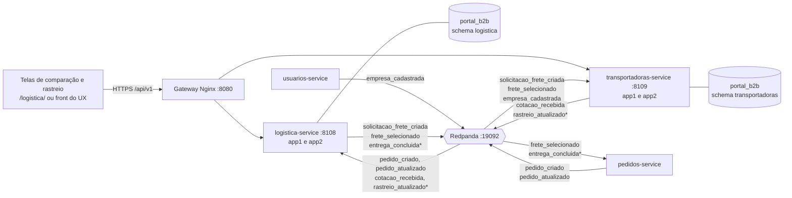
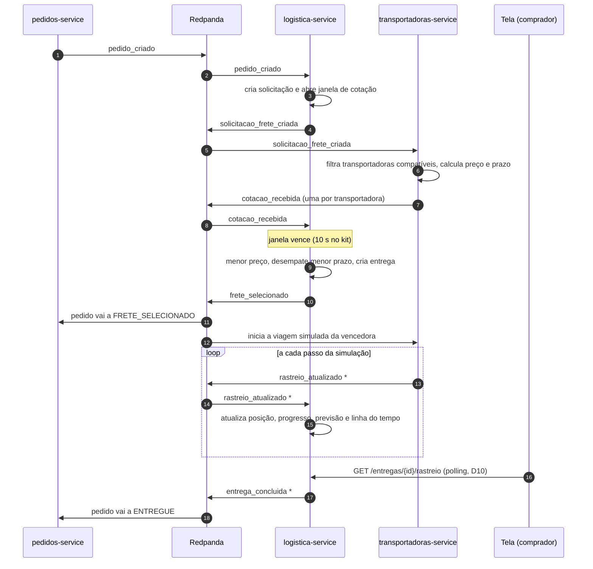
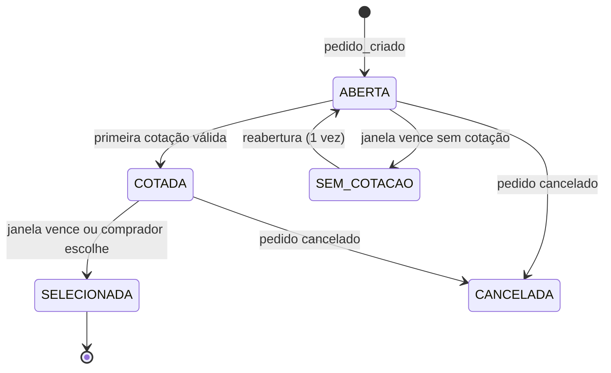
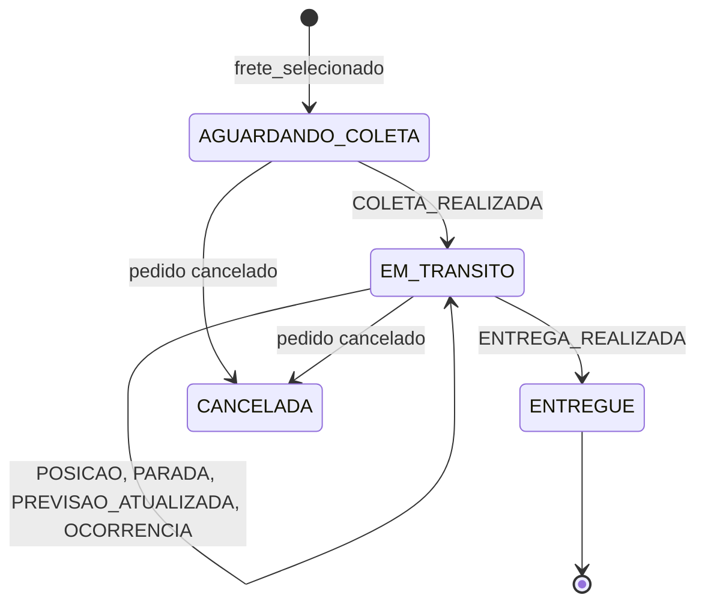

# 02. Arquitetura proposta

Tudo neste documento é **proposta para discussão**. Os pontos que dependem de decisão do grupo apontam para a [pauta](06-pauta-de-decisoes.md) (D1, D2...).

## 1. Visão geral

A proposta mantém os **dois serviços do kit** (D1). O rastreio fica dentro do `logistica-service`, e a simulação das cotações e da viagem fica no `transportadoras-service`, porque no mundo real é a transportadora quem cota e quem informa onde o caminhão está.



`*` tópicos novos (D12). O `transportadoras-service` consumir `frete_selecionado` também é novidade: no catálogo do kit só o `pedidos-service` consome esse tópico.

## 2. Responsabilidades

### 2.1 `logistica-service` (8108)

É o dono da **solicitação de frete**, da **seleção** e da **entrega**. É o único serviço que fala com o resto do portal sobre frete.

| Responsabilidade | Entrada | Saída |
|---|---|---|
| Abrir solicitação de frete | Consome `pedido_criado` | Grava a solicitação com origem, destino, tipo de carga, peso e fim da janela. Publica `solicitacao_frete_criada` |
| Receber cotações | Consome `cotacao_recebida` | Grava a cotação se a solicitação ainda estiver aberta e a cotação for válida |
| Fechar a janela e selecionar | Rotina periódica que encontra janelas vencidas (D4, D14), ou comando do comprador (D5) | Aplica a regra do kit, marca a vencedora, cria a entrega e publica `frete_selecionado` |
| Comparar cotações | `GET` da comparação | Cotações lado a lado com indicadores e o desempenho de cada transportadora (D6) |
| Manter a entrega e o rastreio | Consome `rastreio_atualizado` | Atualiza status, posição, progresso, previsão e linha do tempo |
| Concluir a entrega | Evento `ENTREGA_REALIZADA` no rastreio | Publica `entrega_concluida` |
| Cancelar | Consome `pedido_atualizado` com status `CANCELADO` | Cancela a solicitação ou a entrega |
| Servir as telas | API REST | Solicitações, cotações, comparação, entregas e rastreio |

### 2.2 `transportadoras-service` (8109)

É o dono das **transportadoras**, das **cotações que elas emitem** e da **viagem**.

| Responsabilidade | Entrada | Saída |
|---|---|---|
| Cadastrar transportadoras | Consome `empresa_cadastrada` (empresas do tipo transportadora). Perfil operacional pela API | Tipos de carga, UFs atendidas, capacidade, tabela de preços, frota |
| Cotar automaticamente | Consome `solicitacao_frete_criada` | Filtra as transportadoras compatíveis, calcula preço e prazo e publica um `cotacao_recebida` por transportadora (D3) |
| Receber cotação manual | `POST` do usuário `transportadora` | Valida e publica `cotacao_recebida` |
| Listar cargas disponíveis | Cópia local das solicitações recebidas | Tela "Solicitações de frete" do UX |
| Simular a viagem | Consome `frete_selecionado` quando a vencedora é uma das suas | Agenda a coleta e publica `rastreio_atualizado` a cada passo (D8) |
| Indicadores de desempenho | Resultado das viagens | Entregas feitas, % no prazo, atraso médio, por transportadora e tipo de carga |

## 3. Fluxo ponta a ponta



Pontos em aberto neste fluxo:

- Quem move o pedido de `CRIADO` para `AGUARDANDO_FRETE`? Hoje ninguém faz isso por evento. Uma opção é o `pedidos-service` consumir `solicitacao_frete_criada`; outra é ele já criar o pedido em `AGUARDANDO_FRETE` (ver [eventos](03-eventos-e-integracoes.md), seção 4).
- O que acontece se a janela vencer sem cotação nenhuma? Proposta: a solicitação vai para `SEM_COTACAO`, a logística reabre uma vez com janela maior e, se falhar de novo, registra o problema e o pedido fica em `AGUARDANDO_FRETE` (D4).

## 4. Estados

### 4.1 Solicitação de frete

O kit prevê `ABERTA`, `COTADA` e `SELECIONADA`. A proposta acrescenta `SEM_COTACAO` e `CANCELADA`.



### 4.2 Entrega



`PARADA`, `PREVISAO_ATUALIZADA` e `OCORRENCIA` são eventos da linha do tempo, não estados. A entrega guarda uma marca `com_ocorrencia` para a tela destacar.

## 5. Comparação entre transportadoras

O kit já fixa a regra da **seleção automática**: menor preço e, em empate, menor prazo. A proposta não mexe nela. A comparação serve para o comprador **ver e entender** as opções, e o ranking mostra quem cumpre o que promete (D6).

### 5.1 Comparação das cotações de uma solicitação

Para cada cotação:

| Indicador | Origem |
|---|---|
| Preço total e preço por tonelada·km | Cotação e solicitação |
| Prazo em dias úteis e data prevista de entrega | Cotação |
| Validade da proposta | Cotação |
| Cotação automática ou manual | Cotação |
| % de entregas no prazo, atraso médio, nº de entregas | Indicadores do `transportadoras-service` (cópia local na logística, ver 7.3) |
| Selos: "mais barata", "mais rápida", "mais pontual", "vencedora pela regra" | Calculados na consulta |

Na tela, além da tabela, um **gráfico de dispersão preço × prazo** deixa claro o equilíbrio entre custo e rapidez. Um índice ponderado de custo-benefício pode aparecer só como informação, sem mudar a seleção, a não ser que o professor aceite outra regra (pergunta P2 da pauta).

**Desempate final:** se preço e prazo forem iguais, o kit não diz o que fazer, e o resultado passa a depender da ordem de chegada das mensagens. Proposta: desempatar pelo maior % de entregas no prazo e, por fim, pelo `transportadoraId` em ordem alfabética, para que o resultado seja sempre o mesmo.

### 5.2 Ranking de transportadoras

Visão histórica por transportadora e por tipo de carga: entregas feitas, % no prazo, atraso médio, preço médio por tonelada·km e quantas vezes venceu. Os números vêm das viagens simuladas, então o ranking reflete o comportamento configurado de cada transportadora (ver 5.3).

### 5.3 Motor de cotação simulada

Para a comparação fazer sentido, preço e prazo precisam depender da carga. Proposta de fórmula, com parâmetros por transportadora em `transportadoras.regra_cotacao`:

```
distancia_km = haversine(origem, destino) × 1,3        (fator de sinuosidade da estrada)
preco        = max(preco_minimo, (tarifa_km × distancia_km + tarifa_ton × peso_t) × fator_tipo_carga)
prazo_dias   = prazo_base_dias + ceil(distancia_km / km_por_dia)
```

Exemplo: Sorriso (MT) a Santos (SP), mesmo cenário dos mockups do UX, dá cerca de 1.609 km em linha reta e **≈ 2.090 km** com o fator 1,3.

Transportadoras de exemplo, com perfis diferentes para gerar escolhas diferentes:

| Perfil | Tipos de carga | Característica |
|---|---|---|
| Expressa | `CARGA_SECA`, `GRANEL` | Cara e rápida (`km_por_dia` alto), pontual |
| Econômica | `CARGA_SECA`, `GRANEL` | Barata e lenta, atrasa com frequência |
| Graneleira regional | `GRANEL` | Preço médio, atende só MT, GO, MS, SP e PR |
| Refrigerada | `REFRIGERADO` | Única que leva carga refrigerada |
| Perigosos | `PERIGOSO` | Única habilitada para carga perigosa |

Cada transportadora tem também uma **probabilidade de atraso**, usada pelo simulador da viagem. É isso que alimenta o ranking. Os nomes de exemplo são fictícios.

Para testes, o cálculo precisa ser determinístico. Se houver variação aleatória, ela usa uma semente fixa derivada do `solicitacaoFreteId`.

## 6. Rastreio visual

### 6.1 De onde vem a posição

Do **simulador de viagem** no `transportadoras-service` (D8). Quando recebe `frete_selecionado` de uma solicitação vencida por uma das suas transportadoras:

1. Monta a rota: lista de pontos entre origem e destino (D9: linha interpolada no MVP).
2. Agenda a coleta e publica `COLETA_REALIZADA`.
3. A cada passo, avança o veículo e publica `POSICAO` com coordenadas, progresso e previsão.
4. Pode publicar `PARADA` (descanso do motorista) e, quando sorteia um atraso, `PREVISAO_ATUALIZADA`.
5. No último ponto, publica `ENTREGA_REALIZADA`.

O tempo é acelerado por uma variável de ambiente (`SIM_FATOR_TEMPO`), por exemplo 1 dia de viagem em 1 ou 2 minutos, para caber na apresentação. O usuário `transportadora` também pode informar eventos à mão (opcional).

### 6.2 Coordenadas

O kit não tem endereço com coordenadas. Proposta para o MVP: uma tabela fixa com cerca de 30 cidades relevantes para o cenário (polos do agro e portos), com nome, UF, latitude e longitude (D15). Origem e destino chegam como cidade e UF e são convertidos por essa tabela.

### 6.3 Como a tela recebe as atualizações

Cada serviço roda em duas instâncias (`app1` e `app2`) no mesmo grupo de consumidores. Cada evento de rastreio chega a **uma** delas, mas a tela pode estar ligada à outra. Por isso a tela lê sempre do **banco**, nunca do consumidor em memória.

| Opção | Como funciona | Custo |
|---|---|---|
| **Polling** (recomendado no MVP) | A tela chama `GET /entregas/{id}/rastreio` a cada 5 s | Nenhuma mudança no gateway. Funciona com duas instâncias |
| SSE | `GET /entregas/{id}/stream`; o servidor consulta o banco e empurra mudanças | Exige `proxy_buffering off` e timeout maior no Nginx (pedido à Infra) |
| WebSocket | Canal bidirecional | Exige configuração de upgrade no Nginx. Não precisamos de bidirecional |

### 6.4 Tela

Baseada no mockup do UX (`portal_b2b_07_rastreamento.png`), com **Leaflet** e mapa do **OpenStreetMap**:

- Cabeçalho: status, progresso em %, previsão de chegada, transportadora e veículo.
- Mapa: origem, destino, rota percorrida (linha cheia), rota restante (tracejada) e posição atual do veículo.
- Linha do tempo com os eventos de rastreio.
- Dados da carga (produto, peso, tipo, origem, destino, coleta, previsão).
- Aviso "dados simulados" e fallback em texto se o mapa não carregar (critério UX-RAS-03 do UX).

Quem implementa a tela é a decisão D11.

## 7. Modelo de dados

Proposta para levar ao grupo de Banco de Dados. "Kit" indica que a tabela já existe e será estendida.

### 7.1 Schema `logistica`

| Tabela | Situação | Colunas principais |
|---|---|---|
| `solicitacao_frete` | Kit, estender | `id`, `pedido_id` (único), `produto_id`, `comprador_id`, `fornecedor_id`, `tipo_carga`, `peso_kg`, `origem_cidade`, `origem_uf`, `origem_lat`, `origem_lon`, `destino_*` (iguais), `distancia_km`, `janela_expira_em`, `reaberturas`, `status`, `criado_em` |
| `cotacao` | Kit, estender | `id`, `solicitacao_id`, `transportadora_id`, `preco`, `prazo_dias`, `data_entrega_prevista`, `valida_ate`, `origem_cotacao` (`AUTOMATICA`/`MANUAL`), `observacoes`, `selecionada`, `criado_em`. Única por (`solicitacao_id`, `transportadora_id`) |
| `entrega` | Nova | `id`, `pedido_id` (único), `solicitacao_id`, `cotacao_id`, `transportadora_id`, `status`, `progresso`, `posicao_lat`, `posicao_lon`, `previsao_chegada`, `prazo_prometido`, `com_ocorrencia`, `entregue_em`, `atualizado_em` |
| `evento_rastreio` | Nova | `id`, `entrega_id`, `tipo`, `descricao`, `lat`, `lon`, `progresso`, `ocorrido_em`, `event_id` (único) |
| `desempenho_transportadora` | Nova | Cópia local dos indicadores usados na comparação: `transportadora_id`, `nome`, `entregas`, `pct_no_prazo`, `atraso_medio_h`, `atualizado_em` |
| `outbox` | Nova (D13) | `id`, `topico`, `chave`, `envelope` (JSONB), `criado_em`, `publicado_em` |
| `processed_events` | Kit | `event_id`, `processed_at` |
| `idempotency_keys` | Kit | `key`, `response_payload`, `criado_em` |

### 7.2 Schema `transportadoras`

| Tabela | Situação | Colunas principais |
|---|---|---|
| `transportadora` | Kit, estender | `id`, `empresa_id`, `nome`, `ativa`, `tipos_carga` (array), `ufs_atendidas` (array), `capacidade_kg`, `prob_atraso`, `criado_em` |
| `regra_cotacao` | Kit, estender | `id`, `transportadora_id`, `preco_minimo`, `tarifa_km`, `tarifa_ton`, `fator_tipo_carga` (JSONB), `km_por_dia`, `prazo_base_dias`. Hoje só tem `preco_base` e `prazo_dias` |
| `veiculo` | Nova | `id`, `transportadora_id`, `placa`, `tipo`, `capacidade_kg` |
| `solicitacao_recebida` | Nova | Cópia local de `solicitacao_frete_criada`, para cotar e para a tela de cargas disponíveis |
| `viagem` | Nova | `id`, `pedido_id`, `entrega_id`, `transportadora_id`, `veiculo_id`, `rota` (JSONB com os pontos), `passo_atual`, `status`, `proximo_passo_em`, `lease_ate` (D14) |
| `cidade` | Nova | `nome`, `uf`, `lat`, `lon` (D15). Pode ficar nos dois schemas ou num arquivo estático em cada serviço |
| `outbox` | Nova (D13) | Igual à da logística |
| `processed_events` | Kit | `event_id`, `processed_at` |

### 7.3 Por que a logística guarda cópia dos indicadores

A comparação precisa do desempenho de cada transportadora, que pertence ao `transportadoras-service`. O guia proíbe ler o schema alheio. Há duas saídas:

- **Cópia local** (proposta): a logística atualiza `desempenho_transportadora` a cada `rastreio_atualizado` do tipo `ENTREGA_REALIZADA`, que já traz se a entrega foi no prazo. Não precisa de tópico novo.
- **Consulta HTTP** a `GET /api/v1/transportadoras/ranking` no momento da comparação. É leitura, não avança o fluxo, e o guia permite HTTP "quando estritamente necessário". É mais simples, mas cria dependência síncrona.

## 8. API REST

Todas as rotas exigem JWT. Listagens têm `?page=1&size=10` (`size > 100` → 422). Erros em RFC 7807.

### 8.1 `logistica-service`

| Método e rota | Perfis | Descrição |
|---|---|---|
| `GET /api/v1/logistica/solicitacoes` | comprador (as suas), admin | Lista solicitações, com filtro por status |
| `GET /api/v1/logistica/solicitacoes/{id}` | comprador (a sua), admin | Detalhe, com as cotações |
| `GET /api/v1/logistica/solicitacoes/{id}/comparacao` | comprador (a sua), admin | Cotações lado a lado, indicadores e selos (seção 5.1) |
| `POST /api/v1/logistica/solicitacoes/{id}/selecionar-frete` | comprador (a sua), admin | Seleciona com o corpo vazio (regra do kit) ou com `cotacaoId` (D5). Exige `Idempotency-Key` |
| `GET /api/v1/logistica/entregas` | comprador, fornecedor (os seus), admin | Lista entregas, com filtro por status |
| `GET /api/v1/logistica/entregas/{id}` | idem | Resumo da entrega: status, progresso, previsão, transportadora, veículo, carga |
| `GET /api/v1/logistica/entregas/{id}/rastreio` | idem | Rota, posição atual e linha do tempo. É o que a tela consulta no polling |
| `GET /api/v1/logistica/pedidos/{pedidoId}/entrega` | idem | Busca a entrega pelo pedido, para a tela de pedidos linkar o rastreio |
| `GET /api/v1/logistica/entregas/{id}/stream` | idem | SSE (extra, D10) |
| `POST /api/v1/logistica/entregas/{id}/ocorrencias` | comprador | "Reportar ocorrência" do mockup (extra) |

### 8.2 `transportadoras-service`

| Método e rota | Perfis | Descrição |
|---|---|---|
| `GET /api/v1/transportadoras` | todos | Lista transportadoras homologadas |
| `GET /api/v1/transportadoras/{id}` | todos | Detalhe com perfil operacional e indicadores |
| `PUT /api/v1/transportadoras/{id}/perfil-operacional` | transportadora (a própria), admin | Tipos de carga, UFs, capacidade e tabela de preços |
| `GET /api/v1/transportadoras/ranking` | todos | Ranking de desempenho, com filtro por tipo de carga |
| `GET /api/v1/transportadoras/solicitacoes` | transportadora | Cargas compatíveis abertas para cotação (tela do UX) |
| `POST /api/v1/transportadoras/solicitacoes/{id}/cotacoes` | transportadora | Cotação manual. Publica `cotacao_recebida` |
| `POST /api/v1/transportadoras/viagens/{id}/eventos` | transportadora | Evento manual da viagem (extra) |

Os dois serviços expõem ainda `/health`, `/health/ready` (testando banco e Redpanda de verdade), `/metrics` e `/docs`.

## 9. Pontos de sistemas distribuídos

São os pontos que a disciplina deve cobrar e que precisam aparecer no relatório técnico.

| Problema | Onde aparece | Proposta |
|---|---|---|
| Mensagem entregue mais de uma vez | Todos os consumidores | `processed_events` gravado **na mesma transação** da alteração (o kit guarda em memória) |
| Ordem dos eventos | Cotações e rastreio | Chave de partição = `aggregateId` (`solicitacaoFreteId` para cotações, `pedidoId` para rastreio). O consumidor também ignora eventos de rastreio mais antigos que o último aplicado |
| Gravar no banco e publicar no Kafka sem perder nenhum dos dois | Toda publicação | Outbox transacional: grava o evento numa tabela na mesma transação e uma rotina publica (D13) |
| Duas instâncias e tarefas com tempo | Fim da janela de cotação e passos do simulador | Rotina em cada instância que pega o trabalho vencido com `SELECT ... FOR UPDATE SKIP LOCKED`, para não processar duas vezes (D14) |
| Cotação que chega depois da seleção | Logística | Gravada como atrasada e ignorada na seleção. A seleção é feita com atualização condicional (`WHERE status IN ('ABERTA','COTADA')`) |
| Seleção disparada duas vezes (rotina e comprador ao mesmo tempo) | Logística | A mesma atualização condicional garante uma única vencedora; a segunda tentativa vira 409 ou replay idempotente |
| Tela ligada a outra instância | Rastreio | Tela lê do banco (seção 6.3) |
| Falha permanente | Todos os consumidores | 3 tentativas (1 s, 2 s, 4 s) e envio para `logistica.dlt` ou `transportadoras.dlt` |
