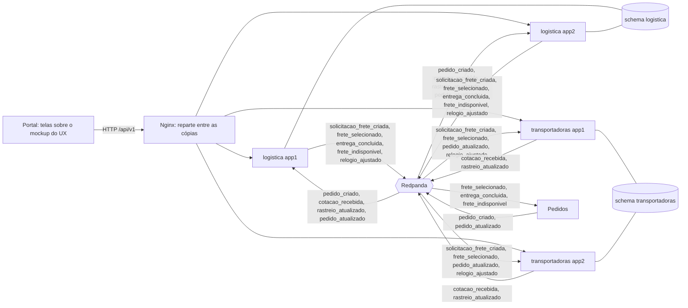

# 07. Relatório técnico

**Grupo 5, Logística e Transporte** · Portal B2B Distribuído · Sistemas Distribuídos (2026)
**Serviços:** `logistica-service` (8108) e `transportadoras-service` (8109)
**Versão:** 1.0 (10/11/2026), ao fim da etapa 5 do [plano](05-plano-de-trabalho.md)

## Como ler este relatório

Este relatório registra **o que foi construído, como foi verificado e por que cada decisão foi tomada**. O detalhe de cada parte está nos documentos de referência, citados em cada seção:

| Documento | Para quê |
|---|---|
| [02. Arquitetura](02-arquitetura-proposta.md) | Diagramas, estados, modelo de dados e API completos |
| [03. Eventos e integrações](03-eventos-e-integracoes.md) | Payload de cada evento e o que pedimos a cada grupo |
| [06. Pauta de decisões](06-pauta-de-decisoes.md) | As decisões D1 a D25 como foram discutidas |
| [`explicacoes/`](explicacoes/) | Cada etapa explicada sem jargão, com as perguntas prováveis do professor |

As decisões aparecem aqui como ADRs (seção 12): contexto, decisão, alternativas consideradas, consequências e situação.

## 1. Introdução

### 1.1 Objetivo

Construir o módulo de logística do portal: a partir de um pedido criado, cotar o frete com as transportadoras, **comparar** as propostas, escolher a vencedora e **acompanhar a entrega num mapa** até a chegada. Comparação e rastreio visual foram pedidos pelo professor além do que o kit de infraestrutura define.

### 1.2 Escopo entregue

| Frente | Situação |
|---|---|
| Cotação e escolha do frete (kit) | Completa: cotação simulada e digitada, escolha pelo comprador ou pela regra do kit, prazos, frete indisponível, cancelamento |
| Comparação entre transportadoras (professor) | Completa: comparação por solicitação (selos, preço por t·km, pontualidade, gráfico) e ranking geral |
| Rastreio visual (professor) | Completo: motoristas e veículos, escala, viagem simulada, mapa, linha do tempo, documentos e ocorrências |
| Telas do mockup do UX | Todas: solicitações, comparação, cargas para cotar, frota, entregas, rastreamento e ranking |
| Requisitos transversais do kit | Todos: RFC 7807, `X-Correlation-Id`, logs JSON, `/health`, `/health/ready`, `/metrics`, `/docs`, paginação, pool de 5 conexões, idempotência, DLT, duas cópias |

### 1.3 Fora do escopo

GPS real, integração com transportadoras ou agregadores reais, documentos fiscais com validade, pagamento do frete, e-mail e SMS, rota por estrada ([01. Contexto](01-contexto-e-escopo.md), seção 4.2).

## 2. Contexto

O portal é dividido entre 9 grupos. Os serviços conversam por eventos num cluster Redpanda (API do Kafka); nenhum serviço lê o banco de outro nem avança o fluxo chamando outro por HTTP.

O grupo atua nos passos finais do fluxo do professor:

| Passo | O que acontece | Serviço |
|---|---|---|
| 8. A logística é acionada | `pedido_criado` abre a solicitação de frete | logística |
| 9. As transportadoras cotam | Cotações simuladas em segundos; cotações digitadas pela tela | transportadoras |
| 10. O frete é escolhido e a entrega acontece | Comprador escolhe (ou a regra do kit, no prazo); motorista escalado; viagem simulada; `entrega_concluida` | os dois |

## 3. Arquitetura

### 3.1 Visão geral



### 3.2 Responsabilidades

| `logistica-service` | `transportadoras-service` |
|---|---|
| Solicitação de frete e prazos | Transportadoras (simuladas e reais), motoristas e veículos |
| Recepção e comparação das cotações | Cotação simulada (motor de preço) e cotação digitada |
| Escolha do frete e troca de transportadora | Escala sorteada do motorista e do veículo |
| Entrega, linha do tempo e rastreio | Simulação da viagem (posição a cada 30 s) |
| Notificações, documentos, ocorrências | Ranking de desempenho |
| Dono do relógio do módulo | Cópia do relógio |

### 3.3 Stack

| Item | Escolha | Por quê |
|---|---|---|
| Linguagem e framework | Python 3.12, FastAPI | Mesma base do kit e dos outros grupos (ADR-020) |
| Banco | PostgreSQL 16, `psycopg` 3 assíncrono, pool de até 5 conexões | Kit; `psycopg` 3 em vez de `psycopg2` porque o serviço é assíncrono (ADR-020) |
| Mensageria | Redpanda (API do Kafka), `aiokafka` | Kit |
| Contratos | JSON Schema (`jsonschema`) | Valida eventos na entrada e na saída (ADR-023) |
| Métricas | `prometheus-client` | `/metrics` real (K10) |
| Documentos | `fpdf2` | PDF sem dependência de sistema (ADR-021) |
| Telas | HTML, CSS e JavaScript puro, Leaflet + OpenStreetMap | Sem etapa de build; entra direto no Nginx (ADR-019) |
| Testes | `pytest`, `httpx`, k6 | Unitários, integração (banco + Kafka) e carga |

### 3.4 Organização do código

| Pasta | Conteúdo |
|---|---|
| `comum/comum/` | Pacote compartilhado: eventos, contratos, outbox, consumidor, relógio, JWT, erros, logs, geografia |
| `services/*/` | Cada serviço: `servico.py` (regras), `api.py` (rotas), `main.py` (montagem), módulos puros testáveis (`regras.py`, `cotacao.py`, `simulacao.py`, `documentos.py`), `migracoes/` |
| `frontend/` | As telas |
| `infra/` | Postgres, tópicos e portal (Nginx) |
| `testes_integracao/`, `testes_carga/` | Testes contra o ambiente no ar |

## 4. Modelo de domínio

| Entidade | Serviço | Estados |
|---|---|---|
| Solicitação de frete | logística | `ABERTA → COTADA → SELECIONADA`; `SEM_COTACAO`, `INDISPONIVEL`, `CANCELADA` |
| Cotação | logística (cópia) e transportadoras (emitida) | `VALIDA`, `RECUSADA_TARDE`, `VIAGEM_RECUSADA` |
| Entrega | logística | `AGUARDANDO_ALOCACAO → AGUARDANDO_COLETA → EM_TRANSITO → ENTREGUE`; `RECUSADA`, `CANCELADA` |
| Viagem | transportadoras | `AGENDADA → EM_TRANSITO → ENTREGUE`; `CANCELADA` |
| Motorista, veículo | transportadoras | ativo/inativo; livre/em viagem |

Diagramas de estado e colunas: [arquitetura](02-arquitetura-proposta.md), seções 4 e 9.

## 5. API REST

15 rotas de negócio na logística e 14 nas transportadoras (além de `/health`, `/health/ready`, `/metrics` e `/docs`), todas em `/api/v1/...`, com JWT, perfis por rota, paginação (`size > 100` → 422) e erros RFC 7807 com `codigo` estável para o QA. A lista está na [arquitetura](02-arquitetura-proposta.md), seção 10, e o Swagger de cada cópia em `/docs`.

## 6. Integração por eventos

| Tópico | Produtor | Consumidores | Chave | Situação |
|---|---|---|---|---|
| `pedido_criado` | pedidos | logística | `pedidoId` | Kit; campos a mais pedidos ao grupo de Pedidos |
| `pedido_atualizado` | pedidos | logística, transportadoras | `pedidoId` | Kit (só o cancelamento é usado) |
| `solicitacao_frete_criada` | logística | transportadoras | `solicitacaoFreteId` | Kit, com campos a mais |
| `cotacao_recebida` | transportadoras | logística | `solicitacaoFreteId` | Kit, com campos a mais |
| `frete_selecionado` | logística | pedidos, transportadoras | `pedidoId` | Kit, com consumidor e campos a mais |
| `rastreio_atualizado` | transportadoras | logística | `pedidoId` | Novo (proposta à Infra) |
| `entrega_concluida` | logística | pedidos | `pedidoId` | Novo (proposta à Infra) |
| `frete_indisponivel` | logística | pedidos | `pedidoId` | Novo (proposta à Infra) |
| `relogio_ajustado` | logística | transportadoras | `relogio` | Novo, interno ao grupo |
| `logistica.dlt`, `transportadoras.dlt` | nós | — | a do original | Kit |

Garantias: envelope do kit; `correlationId` do pedido repassado do começo ao fim; publicação pela outbox (ADR-004); consumo idempotente (ADR-005); ordem por chave de partição e, no rastreio, também por número de sequência (ADR-006). Payloads e JSON Schemas: [eventos](03-eventos-e-integracoes.md) e `comum/comum/contratos/`.

## 7. Segurança

| Tema | Como foi tratado |
|---|---|
| Autenticação | Token RS256 do grupo de Autenticação, validado em cada serviço com a chave pública do JWKS (cache de 1 hora); claims `sub`, `tenant_id`, `active_scope`, `permissions`, `exp` (ADR-026). O formato do kit (HS256) continua disponível por configuração |
| Autorização | Perfis por rota (`exigir_perfis`); visibilidade por empresa (comprador vê os seus pedidos; transportadora só a própria frota); recurso de outra empresa responde 404, não 403, para não revelar que existe |
| Erros | Token ausente/expirado → 401; perfil errado ou ausente → 403 (o kit dava 500, K8) |
| LGPD | CNH completa só no serviço de transportadoras; a logística recebe só os 4 últimos dígitos; telefone e CNH só para comprador e fornecedor da entrega (ADR-025) |
| Banco | Cada serviço usa o seu `svc_*`, que só faz SELECT/INSERT/UPDATE/DELETE no próprio schema (K1, K2) |
| Segredos | Padrões só de desenvolvimento no `docker-compose.yml`, sobrescritos pelo `.env` (fora do Git); chave JWT de 32+ caracteres |
| Login de demonstração | `usuarios-falso` emite tokens RS256 e publica o JWKS, só no ambiente de desenvolvimento (ADR-019, ADR-026) |

## 8. Persistência e consistência

| Problema | Solução | ADR |
|---|---|---|
| Gravar no banco e publicar no Kafka sem perder nenhum dos dois | Outbox transacional | ADR-004 |
| Mensagem entregue mais de uma vez | `processed_events` na mesma transação | ADR-005 |
| Dois atores disputando o mesmo recurso (escolha do frete, troca de transportadora, caminhão) | Gravação condicional + conferência de `rowcount` | ADR-007 |
| Tarefas com hora marcada nas duas cópias | `FOR UPDATE SKIP LOCKED` | ADR-008 |
| Duas cópias vendo horas diferentes | Relógio lido do banco a cada uso, sem cache | ADR-009 |
| Cancelamento chegando antes do pedido ou da escolha do frete (tópicos diferentes) | Tabela `pedido_cancelado` na logística; solicitação marcada `cancelada` nas transportadoras | ADR-013 |
| Notificação de algo que não aconteceu | Notificação na mesma transação da mudança | ADR-022 |

## 9. Tratamento de falhas

| Falha | Comportamento | Verificado |
|---|---|---|
| Processamento falha (banco fora, por exemplo) | 3 novas tentativas (1 s, 2 s, 4 s), depois DLT no formato do kit | Unitário (`comum/tests/test_consumidor.py`) |
| Evento fora do contrato ou com referência inexistente | Direto para a DLT, com o motivo; a fila segue | Etapa 1 (cidade inexistente) |
| Mesma mensagem 5 vezes | Efeito uma vez só | Teste de integração 1 |
| Escolhas simultâneas nas duas cópias + prazo vencendo | Um único `frete_selecionado` | Teste de integração 2 |
| Uma cópia de cada serviço cai no meio da viagem | A outra assume partições e rotinas; sem evento perdido ou repetido no banco | Teste de integração 3 |
| Redpanda fora na subida | O serviço sobe, `/health/ready` responde 503 e o produtor tenta de novo com espera crescente | Só no código (`comum/web.py`, `comum/outbox.py`) |
| Rotina em segundo plano quebra | O supervisor registra e reinicia | Só no código (`comum/tarefas.py`) |
| Mapa não carrega na tela | Origem, destino e última posição em texto | Só no código (`frontend/assets/rastreio.js`) |
| Transportadora escolhida sem caminhão | Recusa e troca automática para a próxima cotação | Etapa 3 |
| Cancelamento chega às transportadoras antes do `frete_selecionado` | A escala não agenda viagem; caminhão e motorista continuam livres | Teste de integração 4 |

## 10. Implantação

**Desenvolvimento:** `docker compose up -d --build` sobe Postgres, Redpanda, Console, as duas cópias de cada serviço, o portal (Nginx), o "Pedidos falso" e o "Usuários falso". Portas escolhidas para não conflitar com o kit. Scripts, migrações e telas vão **dentro das imagens**, porque montar pastas não funciona quando o repositório está num drive virtual (ADR-024).

**Para levar ao kit de infraestrutura**, falta:

1. a Infra criar os tópicos novos e registrar os consumidores novos ([eventos](03-eventos-e-integracoes.md), seção 4);
2. o grupo de Banco aplicar as migrações de `services/*/migracoes/` (sem os seeds `9xx`), no lugar das tabelas do `01-init.sql`;
3. trocar o build dos serviços no `docker-compose.yml` do kit para o nosso (contexto na raiz, por causa do pacote `comum`);
4. apontar `AUTH_JWKS_URL` para o JWKS da Autenticação pelo gateway (`http://gateway:8080/.well-known/jwks.json`) e desligar `pedidos-falso` e `usuarios-falso`. Enquanto o kit não for atualizado, `JWT_ALGORITHM=HS256` com a `JWT_SECRET_KEY` do kit;
5. combinar com a Infra o caminho das telas no gateway (`/logistica/` ou `/app/logistica`).

## 11. Testes e validação

### 11.1 Testes automatizados

| Tipo | Onde | Quantidade | Resultado |
|---|---|---|---|
| Unitários (regras puras: escolha, selos, motor de cotação, simulação, relógio, geografia, contratos, PDFs, token, retentativas e DLT) | `comum/tests`, `services/*/tests` | 104 | Todos passam |
| Integração (contra Redpanda e PostgreSQL de verdade, conferindo banco e tópicos) | `testes_integracao/` | 6 | Todos passam, com o token RS256 (≈ 2 min 45 s) |
| Carga (k6) | `testes_carga/leitura.js` | 1 cenário | Passou (seção 11.3) |

```bash
.venv/Scripts/python -m pytest                       # unitários
.venv/Scripts/python -m pytest testes_integracao -v  # integração (ambiente no ar)
docker run --rm -i --network logistica-grupo5_default grafana/k6:0.54.0 run - < testes_carga/leitura.js
```

### 11.2 Os cenários distribuídos

| Cenário | Como | Conferido |
|---|---|---|
| **Mensagem duplicada** | O mesmo `pedido_criado` (mesmo `eventId`) publicado 5 vezes | 5 cópias no tópico; 1 solicitação; 1 linha em `processed_events`; 4 contadas como duplicadas nas métricas; 1 `solicitacao_frete_criada` na outbox e no tópico; 3 cotações (e não 15) |
| **Várias coisas ao mesmo tempo** | 6 escolhas simultâneas, alternando as duas cópias e os tipos de escolha, mais o relógio acelerado 100.000× no mesmo instante (o prazo de 12 h vence em menos de 1 s e a rotina das duas cópias também tenta escolher) | Respostas só 200 ou 409, no máximo um 200; 1 `frete_selecionado` na outbox e no tópico; 1 entrega |
| **Uma cópia caindo** | Com o caminhão em trânsito, `docker compose stop logistica-1 transportadoras-1`; o relógio é acelerado pelo portal (que manda para a cópia que sobrou) até a entrega | Entrega concluída só com as cópias 2; sequência de rastreio 1..N sem buraco nem repetição no banco; a viagem publicou exatamente N eventos; todas as sequências estão no tópico; 1 `entrega_concluida` na outbox |

| **Fora de ordem entre tópicos** | O `pedido_atualizado` com `CANCELADO` é publicado e processado antes; só depois chega um `frete_selecionado` do mesmo pedido | Nenhuma viagem agendada; o `frete_selecionado` foi processado (está em `processed_events`); a solicitação continua `CANCELADA` |

Mais o **fluxo completo**: pedido → 3 cotações → comparação → escolha do comprador → viagem → `entrega_concluida`, com o mesmo `correlationId` do começo ao fim, notificações, pontualidade e os 4 documentos.

### 11.3 Carga

Critério do kit (guia, seção 10.2): p95 de leitura ≤ 500 ms com 200 requisições simultâneas e menos de 1% de erros. Cenário: 200 usuários virtuais, sem pausa, por 30 s, chamando pelo portal a lista de entregas, o rastreio e a comparação.

| Métrica | Resultado |
|---|---|
| Requisições | 26.433 (866 por segundo) |
| Erros | 0% |
| p95 lista de entregas | 477 ms |
| p95 rastreio | 474 ms |
| p95 comparação | 470 ms |

Passou, **com pouca folga**. O limite vem do pool de 5 conexões por cópia (10 no total), que é regra do kit. A carga real da tela é bem menor: 200 telas abertas consultando a cada 5 s dão 40 requisições por segundo, 20 vezes menos que o teste.

### 11.4 Validação por etapa

Além dos testes automatizados, cada etapa foi validada no ambiente com um roteiro de verificações: 31 na etapa 2, 49 na etapa 3 e 65 na etapa 4, todas passando, e as telas conferidas no navegador. Os resultados estão nas [explicações](explicacoes/).

### 11.5 Especificações para o grupo de Teste e Qualidade

As especificações [ESP-LOG-001](especificacoes/ESP-LOG-001_Logistica.md) (16 requisitos funcionais, 72 critérios de aceitação) e [ESP-TRP-001](especificacoes/ESP-TRP-001_Transportadoras.md) (13 requisitos funcionais, 42 critérios) seguem o modelo ERS-LLM v1.2 do QA. Elas descrevem o código como ele é: os exemplos de resposta e de erro foram capturados do ambiente, e os valores de cotação, distância, datas e sorteio foram calculados pelas mesmas funções do código. Os critérios mais específicos (escolha e replay, cancelamento, DLT com 3 retentativas, Redpanda fora do ar, sorteio do motorista, parada, atraso e entrega da viagem) foram conferidos no ambiente. Escrever as especificações revelou quatro defeitos, corrigidos e cobertos por teste (ver a [explicação 07](explicacoes/07-especificacoes-ers-llm.md)).

## 12. Registro de decisões (ADRs)

### Índice

| ADR | Decisão | Pauta | Situação |
|---|---|---|---|
| 001 | Dois serviços, como no kit | D1 | Aceita |
| 002 | Integração só por eventos | kit | Aceita |
| 003 | Um schema por serviço, usuário só com DML | kit, K1, K2 | Aceita |
| 004 | Outbox transacional | D13 | Aceita |
| 005 | Consumo idempotente, retentativas e DLT | kit, K5 | Aceita |
| 006 | Ordem por chave de partição e por sequência | kit | Aceita |
| 007 | Gravação condicional para recursos disputados | — | Aceita |
| 008 | `FOR UPDATE SKIP LOCKED` nas rotinas | D14 | Aceita |
| 009 | Relógio do módulo no banco, sem cache | D18 | Aceita |
| 010 | Escolha pelo comprador, regra do kit como padrão | D5 | Depende do professor (P2) |
| 011 | Dados de carga no `pedido_criado` | D2 | Depende do grupo de Pedidos |
| 012 | Tópicos novos para rastreio, conclusão e indisponibilidade | D12 | Depende da Infra (P3) |
| 013 | Cancelamento antes do pedido | — | Aceita |
| 014 | Transportadoras simuladas e real | D3, D7 | Aceita |
| 015 | Viagem calculada pelo relógio, com marco | D8, D9 | Aceita |
| 016 | Escala sorteada, recusa e troca | D19, D20 | Aceita |
| 017 | Cópia local da pontualidade | — | Aceita |
| 018 | Tela por consulta a cada 5 s | D10 | Aceita |
| 019 | Telas próprias, portal e usuários de demonstração | D11, D23 | Aceita |
| 020 | Python, FastAPI, `psycopg` 3 e pacote `comum` | D16 | Aceita |
| 021 | Documentos demonstrativos em PDF | D21 | Aceita |
| 022 | Notificações no portal | D22 | Aceita |
| 023 | Contingência com JSON Schema | D23 | Aceita |
| 024 | Ambiente próprio, arquivos dentro das imagens | — | Aceita |
| 025 | CNH mascarada na origem | D19 | Aceita |
| 026 | Token do grupo de Autenticação | D25 | Aceita, depende da Autenticação e da Infra |

### ADR-001: Dois serviços, como no kit

- **Contexto:** o kit já reserva `logistica-service` e `transportadoras-service`, com porta, schema, usuário e rota.
- **Decisão:** manter os dois. Rastreio na logística; cotação, frota e viagem nas transportadoras.
- **Alternativas:** um terceiro serviço só de rastreio, que exigiria porta, schema e rota novos de dois outros grupos.
- **Consequências:** nenhuma dependência nova de infraestrutura; a logística concentra muito (seção 3.2), aceito.

### ADR-002: Integração só por eventos

- **Contexto:** regra do kit: nenhum serviço avança o fluxo chamando outro por HTTP.
- **Decisão:** todo passo entre serviços é um evento no Redpanda. A única leitura entre serviços (pontualidade) usa cópia local (ADR-017).
- **Alternativas:** HTTP para a comparação perguntar a pontualidade.
- **Consequências:** um serviço fora do ar não trava o outro; o fluxo fica assíncrono, e por isso precisamos de idempotência, ordem e outbox.

### ADR-003: Um schema por serviço, usuário só com DML

- **Contexto:** o kit isola cada serviço num schema, mas dava os GRANTs antes de criar as tabelas (K1) e conectava como superusuário (K2).
- **Decisão:** migrações executadas como `portal_ddl`, com os GRANTs no fim; cada serviço conecta com o seu `svc_*`.
- **Consequências:** um serviço não consegue ler o banco do outro nem por engano. As migrações precisam ir para o grupo de Banco.

### ADR-004: Outbox transacional

- **Contexto:** gravar no banco e publicar no Kafka são duas operações; o serviço pode cair entre elas.
- **Decisão:** o evento é gravado na tabela `outbox` na mesma transação; uma rotina publica em ordem, com uma trava (`pg_try_advisory_xact_lock`) para só uma cópia publicar por vez.
- **Alternativas:** publicar depois do commit e aceitar a perda.
- **Consequências:** nenhum evento se perde; um evento pode sair duas vezes ("pelo menos uma vez"), o que a idempotência resolve. A trava limita a vazão de publicação, suficiente para o volume do portal.

### ADR-005: Consumo idempotente, retentativas e DLT

- **Contexto:** o Kafka e a outbox entregam pelo menos uma vez. O kit guardava os eventos processados em memória (K5).
- **Decisão:** `processed_events` gravado na mesma transação da alteração; 3 novas tentativas (1 s, 2 s, 4 s); evento inválido ou falha permanente vai para `<servico>.dlt`; o offset só é confirmado depois.
- **Consequências:** efeito exatamente uma vez no banco (teste de integração 1); uma mensagem ruim não trava a fila.

### ADR-006: Ordem por chave de partição e por sequência

- **Contexto:** o Kafka só garante ordem dentro de uma partição.
- **Decisão:** chave = `aggregateId` (pedido ou solicitação). No rastreio, cada evento leva `sequencia`, e a logística ignora sequência antiga.
- **Consequências:** o caminhão nunca volta no mapa, mesmo com reentrega (teste de integração 3).

### ADR-007: Gravação condicional para recursos disputados

- **Contexto:** a escolha do frete pode vir do comprador e da rotina de prazos, nas duas cópias, ao mesmo tempo; o mesmo vale para a troca de transportadora e para a reserva de caminhão.
- **Decisão:** gravar só se o recurso ainda estiver livre (`WHERE status = 'COTADA'`, `WHERE cotacao_escolhida_id = <recusada>`, `WHERE viagem_atual_id IS NULL`) e conferir quantas linhas mudaram.
- **Alternativas:** `FOR UPDATE` na lista inteira de caminhões, que fazia a segunda viagem ser recusada mesmo sobrando caminhão (problema encontrado na etapa 3).
- **Consequências:** uma única vencedora sem coordenador central (teste de integração 2; etapa 3, três escolhas para dois caminhões).

### ADR-008: `FOR UPDATE SKIP LOCKED` nas rotinas

- **Contexto:** prazos e passos da viagem são tarefas com hora marcada, e as duas cópias rodam as rotinas.
- **Decisão:** cada cópia pega o trabalho vencido com `FOR UPDATE SKIP LOCKED`; o que a outra está tratando é pulado.
- **Alternativas:** só uma cópia rodar as rotinas (para se ela cair); um lease com expiração.
- **Consequências:** sem coordenador; se uma cópia cai, a outra continua (teste de integração 3).

### ADR-009: Relógio do módulo no banco, sem cache

- **Contexto:** a apresentação precisa mostrar dias de viagem em minutos (D18).
- **Decisão:** toda regra de tempo usa `base_virtual + (agora_real − base_real) × fator`, com estado no banco de cada serviço, propagado por `relogio_ajustado` com versão. Leitura a cada uso, sem cache. A rodada automática de 10 s é tempo técnico e corre na hora real.
- **Alternativas:** cache de 2 s, que na etapa 2 deixou as cópias até 2 horas de módulo uma da outra a 3600×.
- **Consequências:** as cópias e os serviços sempre concordam; o relógio acelerado vale só para o nosso módulo.

### ADR-010: Escolha pelo comprador, regra do kit como padrão

- **Contexto:** o kit chama de "inegociável" a regra do menor preço; o grupo quis que o comprador escolha.
- **Decisão:** o comprador escolhe em até 12 h ou clica em "automático"; a regra do kit vale no botão e quando o prazo vence. `Idempotency-Key` obrigatória, guardada no banco.
- **Consequências:** a regra do kit continua testável; precisa do aval do professor (P2).

### ADR-011: Dados de carga no `pedido_criado`

- **Contexto:** sem origem, destino, tipo e peso não há cotação nem mapa.
- **Decisão:** pedir ao grupo de Pedidos os campos ([proposta](contratos/proposta-grupo-pedidos.md)); plano B: cópias locais dos eventos de Produtos, Fornecimento e Autenticação.
- **Consequências:** maior dependência externa do projeto; até o acordo, o "Pedidos falso" publica no formato proposto, validado pelo mesmo JSON Schema (ADR-023).

### ADR-012: Tópicos novos

- **Contexto:** o kit não tem como avisar posição, conclusão nem indisponibilidade do frete, e `pedido_atualizado` é do grupo de Pedidos.
- **Decisão:** `rastreio_atualizado`, `entrega_concluida`, `frete_indisponivel` e `relogio_ajustado`.
- **Alternativas:** `PATCH` HTTP no serviço de Pedidos (contra a regra do kit); publicar no tópico de outro grupo.
- **Consequências:** depende da aprovação da Infra (P3).

### ADR-013: Cancelamento antes do pedido

- **Contexto:** `pedido_criado` e `pedido_atualizado` são tópicos diferentes; não há ordem garantida entre eles.
- **Decisão:** um cancelamento de pedido desconhecido é guardado em `pedido_cancelado`; o pedido que chega depois não abre solicitação.
- **Consequências:** nenhum frete é contratado para pedido já cancelado.
- **Complemento (depois da etapa 5):** o mesmo problema existia entre `pedido_atualizado` e `frete_selecionado` nas transportadoras: com o cancelamento chegando primeiro, a escala agendava a viagem e prendia caminhão e motorista. Agora a escala confere se a solicitação foi cancelada. O teste de integração 4 reproduz a ordem ruim; ele falhou antes da correção e passa depois.

### ADR-014: Transportadoras simuladas e real

- **Contexto:** não há transportadoras de verdade; o mockup do UX tem tela para a transportadora digitar a cotação.
- **Decisão:** cinco transportadoras simuladas com perfis diferentes (motor de preço por distância, peso e tipo) e uma real (Rodovia Sul), que só cota digitando. As duas cotações viajam no mesmo evento.
- **Alternativas:** API de agregador (feita para encomendas, não para carga fechada).
- **Consequências:** a comparação tem escolhas reais a fazer; o motor fica atrás de uma interface para trocar depois.

### ADR-015: Viagem calculada pelo relógio, com marco

- **Contexto:** posição sem GPS; o relógio pode ser acelerado.
- **Decisão:** a posição sai do relógio (fração do tempo entre coleta e chegada); quando o atraso aparece, o cálculo parte de um "marco" no ponto atual; rota em linha reta de 60 pontos.
- **Consequências:** acelerar o relógio acelera a viagem sem mudar código; o caminhão nunca volta; a rota não segue estradas (limitação aceita).

### ADR-016: Escala sorteada, recusa e troca

- **Contexto:** a transportadora vencedora pode não ter caminhão livre no momento da escolha.
- **Decisão:** só cota quem tem frota livre; na escala, sorteio reproduzível (semente = id da entrega) e reserva condicional; sem frota, `VIAGEM_RECUSADA`, e a logística troca para a próxima cotação.
- **Consequências:** nenhum pedido fica parado por falta de caminhão enquanto houver outra cotação.

### ADR-017: Cópia local da pontualidade

- **Contexto:** a comparação precisa da pontualidade, que é das transportadoras.
- **Decisão:** a logística atualiza `desempenho_transportadora` a cada entrega concluída, que ela mesma acompanha. O ranking completo é calculado no serviço de transportadoras com os dados dele.
- **Consequências:** a tela de comparação não depende do outro serviço; os dois números podem divergir por instantes (consistência eventual).

### ADR-018: Tela por consulta a cada 5 s

- **Contexto:** o evento de rastreio chega a uma cópia; a tela pode estar na outra.
- **Decisão:** a tela consulta o banco pela API a cada 5 s.
- **Alternativas:** SSE ou WebSocket, que exigem repassar o evento entre as cópias e ajustes no gateway.
- **Consequências:** simples e funciona com qualquer cópia; até 5 s de atraso na tela (a posição muda a cada 30 s).

### ADR-019: Telas próprias, portal e usuários de demonstração

- **Contexto:** rastreio e comparação foram pedidos a nós; o UX entregou o design.
- **Decisão:** telas próprias no layout do mockup, servidas por um Nginx que também faz o papel do gateway; login de demonstração pelo `usuarios-falso` (só desenvolvimento).
- **Consequências:** demonstração independente dos grupos de UX e Autenticação; o caminho das telas no gateway do kit ainda precisa ser combinado.

### ADR-020: Python, FastAPI, `psycopg` 3 e pacote `comum`

- **Contexto:** o kit usa `psycopg2` (síncrono) e uma pasta `common` que não entrava na imagem (K4).
- **Decisão:** `psycopg` 3 assíncrono com `psycopg_pool`; código compartilhado como pacote `comum` instalado nas duas imagens.
- **Consequências:** nenhuma consulta trava o processo; os boilerplates do kit não foram reaproveitados, e as correções estão registradas na [análise do kit](04-analise-do-kit.md).

### ADR-021: Documentos demonstrativos em PDF

- **Decisão:** CT-e, romaneio, nota fiscal e comprovante de coleta gerados na hora com `fpdf2`, com marca d'água "sem valor fiscal" e número fictício estável.
- **Consequências:** nada guardado; documento fiscal real fica fora do escopo.

### ADR-022: Notificações no portal

- **Decisão:** notificações por empresa e papel, gravadas na mesma transação da mudança; contador no sino.
- **Alternativas:** e-mail ou SMS.
- **Consequências:** nunca avisa algo desfeito; não chega a quem está fora do portal.

### ADR-023: Contingência com JSON Schema

- **Decisão:** `publicar_pedido_falso`, `cancelar_pedido_falso` e o contêiner `pedidos-falso` fazem o papel do grupo de Pedidos, sempre no formato validado pelo mesmo JSON Schema que o serviço usa.
- **Consequências:** os testes não passam com um formato que o serviço real recusaria.

### ADR-024: Ambiente próprio, arquivos dentro das imagens

- **Contexto:** montar pastas do host não funcionou no drive em que o repositório está.
- **Decisão:** `docker-compose.yml` próprio, com scripts, migrações e telas copiados para dentro das imagens.
- **Consequências:** funciona em qualquer máquina do grupo; mudar uma migração exige `docker compose down -v` e mudar uma tela exige `--build`.

### ADR-025: CNH mascarada na origem

- **Decisão:** a CNH sai do serviço de transportadoras já mascarada; a logística nunca vê o número completo.
- **Consequências:** o dado pessoal fica num lugar só; a transportadora vê a CNH completa só na tela da própria frota.

### ADR-026: Token do grupo de Autenticação

- **Contexto:** o kit usa HS256 com chave compartilhada, o que permite a qualquer serviço emitir tokens. O grupo de Autenticação definiu RS256 com JWKS e os claims `tenant_id` e `active_scope` (L16).
- **Decisão:** validar o token RS256 com a chave pública do `kid` (JWKS com cache de 1 hora), com o algoritmo fixo na configuração. `BUYER`, `SUPPLIER` e `CARRIER` viram comprador, fornecedor e transportadora; o admin do módulo é quem tem a permissão `logistica:admin`; `TENANT_ADMIN` sozinho recebe 403. `JWT_ALGORITHM=HS256` volta ao formato do kit.
- **Alternativas:** esperar o kit mudar (o login real não funcionaria); tratar `TENANT_ADMIN` como admin (o administrador de uma empresa veria as entregas de todas e mexeria no relógio).
- **Consequências:** nenhum serviço consegue forjar token; o portal entra com o mesmo token dos outros grupos. A permissão `logistica:admin` ainda precisa ser confirmada pela Autenticação.

## 13. Limitações conhecidas

| Limitação | Efeito | Possível evolução |
|---|---|---|
| Rota em linha reta, 35 cidades com coordenadas aproximadas | O mapa não segue estradas; cidade fora da lista vai para a DLT | Rota pelo OSRM; base do IBGE |
| Grupo de Pedidos ainda não integrado | O fluxo real depende do "Pedidos falso" | Fechar o contrato (ADR-011) |
| Tópicos novos não aprovados | Não existem no kit | Aprovação da Infra (ADR-012) |
| Migrações sem controle de versão | Só rodam com o banco vazio | Ferramenta de migração (Alembic, Flyway) |
| Publicação da outbox serializada | Vazão de publicação limitada | Trava por chave em vez de global |
| p95 de leitura perto de 500 ms com 200 usuários | Pouca folga no critério do kit | Índices específicos, cache de leitura curta, mais cópias |
| Carga de escrita não medida | O critério de escrita do kit (p95 ≤ 1000 ms) não foi verificado | Cenário k6 de escolha de frete |
| Notificações por empresa, não por usuário | Todos da empresa veem as mesmas | Destinatário por usuário |
| Login de demonstração com token de 8 h | Só desenvolvimento | Usar o `usuarios-service` |
| Permissão `logistica:admin` é proposta nossa | Sem ela, ninguém da Autenticação real consegue ser admin do módulo (relógio, todas as entregas) | Confirmar com a Autenticação (ADR-026) |
| Tela de login só de demonstração | O portal entra pelo `usuarios-falso`, não pelo login e pela troca de contexto da Autenticação | Usar o login da Autenticação no gateway |
| Especificações ERS-LLM ainda sem a revisão do QA (gate G1) | Podem mudar depois da revisão; notificações, ocorrências e documentos ficaram para a versão 1.1 | Revisão do QA; ESP 1.1 |
| O relógio do módulo só acelera e adianta | Um teste não consegue pôr o relógio num instante exato; os critérios com data conferem relações a partir do `aberta_em` | Rota de teste para fixar o relógio, só no ambiente de desenvolvimento |
| `SEM_TRANSPORTADORA` com dois status | 404 em `/minha`, 403 nas rotas de cargas e cotação | Unificar em 403 junto com a tela |

## 14. Divergências em relação ao kit e ao planejado

| Item | Kit ou plano | Implementado | Motivo |
|---|---|---|---|
| Janela de 10 s e escolha automática | Kit | Rodada de 10 s + prazo de 12 h para o comprador | D4, D5 |
| Quem escolhe | Kit: sempre o menor preço | Comprador; o menor preço é o padrão | ADR-010 |
| Driver do banco | Kit: `psycopg2` | `psycopg` 3 | ADR-020 |
| Código comum | Kit: `services/common` | Pacote `comum` | K4 |
| Tabelas | `01-init.sql` do kit | Migrações próprias, com mais colunas | ADR-003 |
| Consumidores | Kit: só Pedidos consome `frete_selecionado` | Transportadoras também; e `pedido_atualizado` | Escala e cancelamento |
| Tópicos | 15 do kit | +4 novos | ADR-012 |
| Telas | Plano inicial: UX ou nós | Nós, sobre o mockup do UX | D11 |
| Cache do relógio | Primeira versão: 2 s | Sem cache | ADR-009 |
| Reserva de caminhão | Primeira versão: `FOR UPDATE` em lista | Gravação condicional | ADR-007 |
| Conteúdo da DLT | Kit: `originalEvent`, `error`, `stackTrace`, `failedAtAttempt` | Os mesmos, mais `originalTopic` | Corrigido depois da etapa 5 (a primeira versão usava `eventoOriginal`, `erro` e `tentativas`) |
| Token | Kit: HS256, `empresaId`, `perfil` | RS256 da Autenticação; HS256 por configuração | ADR-026 |

## 15. Pendências com outros grupos

| Grupo | Pendência |
|---|---|
| Mercado, Negociação e Pedidos | Responder à [proposta de contrato](contratos/proposta-grupo-pedidos.md) |
| Infraestrutura | Tópicos novos, consumidores novos, correções do kit, caminho das telas no gateway |
| Banco de Dados | Aplicar as migrações e a correção dos GRANTs |
| Fornecimento e Produtos | Listas de tipos de transporte e de unidades iguais nos dois lados; falta responder P-27 (o tipo chega pelo `pedido_criado`) e pedir a origem do fornecimento em cidade e UF e o peso por unidade |
| Autenticação | Confirmar a permissão `logistica:admin` (ADR-026); cidade e UF da empresa, que o `empresa_cadastrada` não traz |
| Teste e Qualidade | Revisar a ESP-LOG-001 e a ESP-TRP-001 (gate G1) |
| Professor | P1 (posição simulada), P2 (escolha pelo comprador), P3 (tópicos novos), data da apresentação |

## 16. Referências

- Kit de infraestrutura: <https://github.com/Printf-PedroCardoso/portal-b2b-kit-infra> (commit `630515c`).
- Grupo de Fornecimento e Produtos (modelo deste relatório e itens K1 a K11): <https://github.com/davicalvarenga/Sistema-MicServ-SD>.
- Grupo de UX/UI (mockups): <https://github.com/HugoParzival007/portal-b2b-UI-UX>.
- Grupo de Teste e Qualidade (modelo ERS-LLM): <https://github.com/AmandaBfa/AED---Processo-e-Artefato-SD->.
- Padrões: RFC 7807 (Problem Details), RFC 7519 (JWT), Transactional Outbox, Idempotent Consumer.

## Histórico de revisões

| Versão | Data | Mudança |
|---|---|---|
| 1.0 | 10/11/2026 | Primeira versão, ao fim da etapa 5 (testes de integração e de carga) |
| 1.1 | 10/11/2026 | Integração com as definições dos outros grupos: token RS256 da Autenticação (ADR-026), DLT no formato do kit, `fornecimentoId` aceito no `pedido_criado`, pendências da seção 15 |
| 1.2 | 10/11/2026 | Especificações ESP-LOG-001 e ESP-TRP-001 (seção 11.5) e os quatro defeitos achados ao escrevê-las; 104 testes unitários e 6 de integração |
