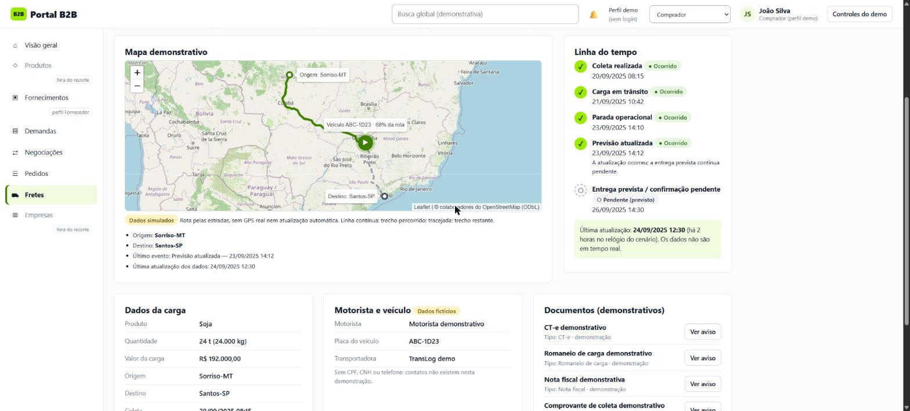

# Tela de rastreamento: guia para o grupo de UX/UI

Do grupo 5 (Logística e Transporte) para o grupo de UX/UI, 27/11/2026.

O professor pediu uma tela de rastreamento mais real: o caminhão seguindo as estradas, e não um desenho. Este guia mostra o que mudar no site de vocês, já testado aqui.

## Respostas rápidas

| Pergunta | Resposta |
|---|---|
| Precisa criar uma página nova? | **Não.** A tela continua em `/fretes/entregas/FR-1084`. Só o bloco "Mapa demonstrativo" muda |
| O que precisa alterar? | 5 arquivos do produto R5 (o que está publicado na Vercel): `index.html`, `fixtures.json`, `js/pages.js`, `css/app.css` e um teste (`test/e2e/run-e2e.mjs`). Tudo está no arquivo [`mapa-real.patch`](mapa-real.patch) |
| Precisa de servidor, API ou login? | Não. Continua sendo demonstração com dados fictícios (a rota vai na fixture) |
| Os requisitos UX-RAS mudam? | Não. 68% da rota, "Dados simulados", texto quando o mapa falha e nenhum link externo: tudo continua valendo e foi conferido |

## 1. Antes e depois

| | Antes | Depois |
|---|---|---|
| Mapa | Desenho fixo em SVG (uma curva entre dois pontos) | Mapa de verdade (Leaflet sobre o OpenStreetMap) |
| Trajeto | Curva genérica | Rota de Sorriso a Santos pelas estradas: 216 pontos, 2.115 km, passando por Cuiabá e Uberlândia |
| Veículo | Quadrado no meio da curva | Marcador no ponto de 68% da rota (perto de Uberlândia), com "Veículo ABC-1D23 · 68% da rota" |
| Trecho percorrido e restante | Contínuo e tracejado, desenhados à mão | Contínuo até o caminhão e tracejado depois, calculados pela distância real |
| Mapa indisponível | Texto com origem, destino e último evento | Igual (e também quando o Leaflet não carrega) |



A rota é a mesma que o nosso serviço usa na viagem simulada (decisão D9 do grupo 5). Ela está em [`rota-sorriso-santos.json`](rota-sorriso-santos.json), gerada a partir do OpenStreetMap (licença ODbL).

## 2. Passo a passo

> **Atenção:** o produto R5 (`experimentos/R5-20261119T114138Z/geracao_inicial/produto/`) está congelado. Os 5 arquivos que mudam estão no `MANIFESTO_PRODUTO.json` com SHA-256, e o `.gitattributes` preserva os bytes. **Não editem essa pasta**: isso invalida a evidência da homologação. Copiem o produto para uma pasta nova e mudem a cópia.

1. Na raiz do repositório de vocês, copiem o produto para uma pasta nova (o nome é sugestão):
   ```bash
   cp -r experimentos/R5-20261119T114138Z/geracao_inicial/produto produto-publicado
   ```
2. Baixem o [`mapa-real.patch`](mapa-real.patch) para a raiz do repositório e apliquem na cópia:
   ```bash
   git apply --directory=produto-publicado mapa-real.patch
   ```
   No Windows, se o Git reclamar de fim de linha, usem `git -c core.autocrlf=false apply --directory=produto-publicado mapa-real.patch`.
3. Testem localmente:
   ```bash
   cd produto-publicado
   npm start            # http://127.0.0.1:4178/fretes/entregas/FR-1084
   ```
   E rodem os testes de vocês, como sempre: `npm test` e `npm run test:e2e`.
4. Na Vercel, troquem a pasta publicada (Settings → General → Root Directory) para `produto-publicado/public`.
5. **Links diretos (aproveitem para corrigir):** hoje, na Vercel, só a raiz abre. `https://portal-b2b-ui-ux-public.vercel.app/dashboard` responde 404 (conferido em 27/11), e o mesmo vale para `/fretes/entregas/FR-1084`. O `server.js` local manda essas rotas para o `index.html`, mas a Vercel não. Criem `produto-publicado/public/vercel.json` com:
   ```json
   { "rewrites": [{ "source": "/(.*)", "destination": "/index.html" }] }
   ```
   Os arquivos que existem (`/js/app.js`, `/fixtures.json`...) continuam sendo servidos normalmente; o resto vai para o `index.html`.

Testamos aqui: o patch aplica na cópia, deixa o R5 congelado intacto e a tela passa nas verificações UX-RAS-03/A, UX-RAS-03/B e UX-RAS-06/B (as que tocam no mapa).

## 3. O que o patch muda, arquivo por arquivo

| Arquivo | Mudança |
|---|---|
| `public/index.html` | Carrega o Leaflet 1.9.4 (CSS e JS, pelo unpkg) **antes** do `app.js` |
| `public/fixtures.json` | Campo `rota` no cenário `RAS-A`: a lista de pontos `[latitude, longitude]` de Sorriso a Santos (e `rota_fonte`, com a licença) |
| `public/js/pages.js` | No bloco do mapa de `rastreamento()`, o SVG dá lugar ao mapa do Leaflet. Três funções novas antes de `rastreamento()`: `distanciaKm`, `dividirRota` (separa a rota no ponto de 68%) e `desenharMapaReal` |
| `public/css/app.css` | Altura do mapa (`.map-canvas`), marcadores de origem, destino e caminhão |
| `test/e2e/run-e2e.mjs` | O UX-RAS-03/A lia o `<title>` do SVG antigo; agora lê a descrição acessível do mapa novo (`aria-label` de `#ras-leaflet`), que tem o mesmo conteúdo |

Três armadilhas que já resolvemos no patch, para vocês não caírem nelas se mexerem no código:

1. **`L` já tem dono.** Em `pages.js` e `core.js`, `L` é o módulo `logic.js` (`L.formatDateTime`...). O Leaflet também se chama `L`, mas no `window`. O código usa `window.L` para o Leaflet.
2. **A regra `.map svg { width: 100% }`** do mapa antigo também pega os SVGs que o Leaflet cria: a linha da rota some e a bandeira dos créditos fica gigante. O patch acrescenta `.map-canvas svg { width: auto; height: auto; }`.
3. **Nenhum link externo ativo (UX-RAS-06/B).** Por padrão, os créditos do Leaflet e do OpenStreetMap têm links, e o teste reprova. O patch deixa os créditos em texto: "Leaflet | © colaboradores do OpenStreetMap (ODbL)". O crédito ao OpenStreetMap é obrigatório pela licença; o link, não.

O caminhão fica parado nos 68%, como pede a fixture (UX-RAS-01: o progresso é o da fixture, e UX-RAS-04: os dados não são em tempo real).

## 4. E se o professor quiser a tela com dados reais?

A tela real de rastreamento já existe no portal integrado: é a do grupo 5, feita sobre o mockup de vocês. Ela fica em `/logistica/entrega.html?id=<id da entrega>`, no mesmo gateway das APIs, com o caminhão andando pela rota, linha do tempo, ocorrências e documentos.

Para a tela **de vocês** ler a nossa API, há dois obstáculos hoje:

| Obstáculo | Por quê |
|---|---|
| Origem diferente | O site está na Vercel, e a API está no gateway da AWS. O navegador só deixa uma página chamar outro endereço se a API responder com CORS, e o gateway não responde |
| HTTPS | O endereço HTTPS da AWS (`https://portal-b2b-integracao-alb-...elb.amazonaws.com`) falha na verificação do certificado (conferido em 27/11). Uma página HTTPS não pode chamar uma API HTTP |
| Login | As rotas exigem o token do Identity-Service (`Authorization: Bearer ...`), com perfil comprador, fornecedor ou admin |

O caminho sem esses obstáculos é a página ficar no próprio gateway, como as telas dos outros grupos (`frontends/apps/<grupo>/` no kit da Infra). Se for esse o pedido, este é o mapa da fixture `RAS-A` para a nossa API (detalhes na [ESP-LOG-001](../../especificacoes/ESP-LOG-001_Logistica.md)):

| Na fixture `RAS-A` | Na API do grupo 5 |
|---|---|
| `id` ("FR-1084") | `id` da entrega; o título usa `pedido_id` (API-09) |
| "Em transporte" | `status`: `AGUARDANDO_ALOCACAO`, `AGUARDANDO_COLETA`, `EM_TRANSITO`, `ENTREGUE`, `RECUSADA`, `CANCELADA` (API-09) |
| `rota_percentual` | `progresso` × 100 (API-10) |
| `eventos_concluidos` / `eventos_total` | Quantas destas etapas já aconteceram em `eventos` (API-10): `VIAGEM_ALOCADA`, `COLETA_REALIZADA`, `POSICAO`, `PARADA`, `ENTREGA_REALIZADA` (de 5) |
| `previsao` | `previsao_chegada` (API-09) |
| `transportadora`, `veiculo`, `motorista` | `transportadora_nome`, `veiculo_placa`, `motorista_nome` (API-09). Telefone e CNH vêm `null` para o comprador |
| `origem`, `destino` | `origem_cidade` e `origem_uf` (API-09); coordenadas em `origem` e `destino` (API-10) |
| `quantidade_kg`, `valor_centavos`, `coleta` | `peso_kg`, `valor_carga` (em reais, não em centavos), `coletada_em` ou `coleta_prevista` (API-09) |
| `ultima_atualizacao` | `posicaoEm` (API-10) |
| `eventos[]` (`nome`, `data`, `descricao`) | `eventos[]` (`tipo`, `ocorrido_em`, `descricao`) e `ocorrencias[]` (API-10) |
| `rota` (do patch) | `rota`: a mesma lista de `[latitude, longitude]` (API-10) |
| Documentos (aviso) | PDF de verdade: `GET /entregas/{id}/documentos/{cte, romaneio, nota-fiscal ou comprovante-coleta}` (API-16) |
| Ocorrência (protocolo local) | `POST /entregas/{id}/ocorrencias` com `{"tipo": "ATRASO", "AVARIA", "DESVIO_ROTA" ou "OUTRO", "descricao": 1 a 500 caracteres}`; devolve o `id`, que serve de protocolo (API-15) |

Rotas, todas em `/api/v1/logistica`:

| Para quê | Rota |
|---|---|
| Lista de entregas do usuário | `GET /entregas?page=1&size=20` (API-08) |
| Da tela do pedido para o rastreio | `GET /pedidos/{pedido_id}/entrega` (API-11) devolve a entrega do pedido |
| Resumo, carga, motorista e veículo | `GET /entregas/{id}` (API-09) |
| Rota, posição, progresso e linha do tempo | `GET /entregas/{id}/rastreio` (API-10) |
| Hora do módulo (o relógio que o admin acelera) | `GET /relogio` (API-12) |

Nesse caso, aí sim muda a rota da tela: de `/fretes/entregas/FR-1084` para `/fretes/entregas/:id`. Hoje o `ROUTES` do `core.js` e o do `server.js` só aceitam caminhos exatos. A tela deve consultar a API a cada 5 s (2 s com o relógio acelerado) e mostrar as datas na hora do módulo, não na hora do computador.

## 5. Dúvidas

Abram uma issue no nosso repositório: https://github.com/ArrozbR/portal-b2b-logistica-transporte/issues
