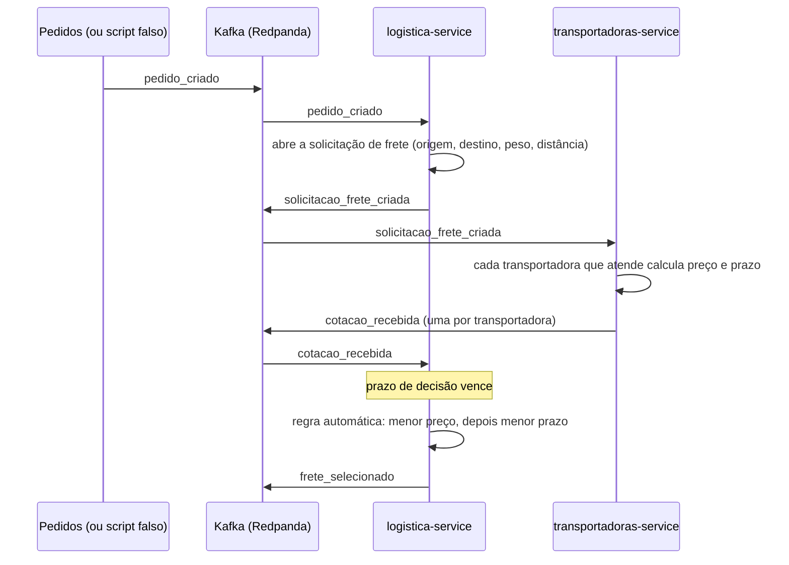

# 01. Base dos serviços e fluxo automático do frete

Etapa 1 do [plano](../05-plano-de-trabalho.md). Este arquivo explica, sem jargão, o que foi construído, por que foi feito assim e o que o professor pode perguntar.

## 1. O que esta parte faz

Um pedido entra e, sem ninguém clicar em nada, sai um frete escolhido:



Ainda **não** tem nesta etapa: o comprador escolhendo (etapa 2), o relógio acelerado pela tela (etapa 2), motorista, caminhão e mapa (etapa 3).

## 2. Onde está cada coisa

| Pasta | O que tem |
|---|---|
| `comum/comum/` | Código usado pelos dois serviços: eventos, banco, outbox, consumidor, relógio, login (JWT), erros, logs |
| `comum/comum/contratos/` | O formato de cada evento (JSON Schema). Se um evento não seguir o formato, ele é recusado |
| `services/logistica-service/logistica/` | Regras da logística: abrir solicitação, receber cotação, escolher o frete |
| `services/transportadoras-service/transportadoras/` | Regras das transportadoras: quem atende e quanto cobra |
| `services/*/migracoes/` | As tabelas do banco de cada serviço |
| `docker-compose.yml` | Sobe tudo: banco, Kafka e as duas cópias de cada serviço |

## 3. As ideias principais

### 3.1 Cada serviço tem o seu banco e só conversa por mensagens

A logística nunca lê as tabelas das transportadoras, e vice-versa. Cada serviço entra no banco com um usuário que só enxerga o seu próprio schema (`svc_logistica` só vê `logistica`). Para saber algo do outro, o serviço espera uma mensagem no Kafka.

**Por quê:** se um serviço cai ou muda as tabelas, o outro continua funcionando. É a regra número 4 do kit.

### 3.2 Outbox: gravar e avisar sem perder nada

Quando a logística abre uma solicitação, ela precisa fazer duas coisas: **gravar no banco** e **mandar a mensagem no Kafka**. Se fizesse uma depois da outra, poderia cair no meio:

- gravou e caiu antes de mandar → as transportadoras nunca ficam sabendo;
- mandou e caiu antes de gravar → as transportadoras cotam uma solicitação que não existe.

A solução: a mensagem também é **gravada no banco**, numa tabela chamada `outbox`, **na mesma transação**. Uma transação é "tudo ou nada": ou as duas gravações acontecem, ou nenhuma. Depois, uma rotina lê a `outbox` e manda as mensagens para o Kafka (`comum/comum/outbox.py`).

**Efeito colateral:** se o serviço cair depois de mandar a mensagem e antes de marcar como enviada, ela é enviada de novo quando ele voltar. Por isso o item 3.3 existe.

### 3.3 Idempotência: a mesma mensagem duas vezes não faz efeito duas vezes

O Kafka garante que a mensagem chega **pelo menos uma vez**, não **exatamente uma vez**. Então todo consumidor guarda o `eventId` de cada mensagem processada na tabela `processed_events`, **na mesma transação** em que faz a alteração. Se a mesma mensagem chegar de novo, o `eventId` já está lá e ela é ignorada (`comum/comum/consumidor.py`).

Além disso, há travas no próprio dado: um pedido só pode ter uma solicitação (`pedido_id UNIQUE`) e uma transportadora só uma cotação por solicitação.

### 3.4 Retentativas e DLT

Se processar uma mensagem falhar (o banco caiu, por exemplo), o consumidor tenta de novo depois de 1 s, 2 s e 4 s. Se continuar falhando, ou se a mensagem estiver fora do formato (cidade que não existe, campo faltando), ela vai para o tópico `logistica.dlt` com o motivo. Assim uma mensagem ruim nunca trava as outras.

### 3.5 Duas cópias de cada serviço

O kit roda cada serviço duas vezes (`app1` e `app2`). Isso cria dois problemas, e cada um tem a sua solução:

| Problema | Solução |
|---|---|
| As duas cópias recebem a mesma mensagem? | Não: as duas estão no mesmo **grupo de consumidores** do Kafka, e o Kafka entrega cada mensagem a só uma delas |
| As duas cópias verificam os prazos a cada segundo. Podem escolher o frete da mesma solicitação ao mesmo tempo? | Não: cada uma pega a solicitação vencida com `FOR UPDATE SKIP LOCKED`. "FOR UPDATE" trava a linha; "SKIP LOCKED" faz a outra cópia pular a linha travada em vez de esperar |
| As duas cópias publicam a outbox ao mesmo tempo, fora de ordem? | Não: só publica quem pega a trava `pg_try_advisory_xact_lock`; a outra espera a próxima rodada |

### 3.6 A escolha do frete só acontece uma vez

A gravação da escolha tem uma condição:

```sql
UPDATE logistica.solicitacao_frete SET status = 'SELECIONADA', ...
 WHERE id = :id AND status = 'COTADA'
```

Se duas tentativas chegarem juntas, o banco executa uma de cada vez. A primeira muda o status e altera 1 linha. A segunda não encontra mais `COTADA`, altera 0 linhas e desiste. Só quem alterou 1 linha grava o `frete_selecionado` (`services/logistica-service/logistica/servico.py`, função `escolher`).

### 3.7 Regra automática

Menor preço; em empate, menor prazo; depois, a transportadora mais pontual; por fim, o identificador da transportadora em ordem alfabética. O último critério existe para o resultado nunca depender da ordem de chegada das mensagens (`logistica/regras.py`).

### 3.8 Como as transportadoras simuladas cobram

```
preço = máximo(preço mínimo, (tarifa por km × distância + tarifa por tonelada × peso) × fator do tipo de carga)
prazo = prazo base + distância ÷ km rodados por dia (arredondado para cima)
```

A distância é a linha reta entre as cidades vezes 1,3 (estrada não é reta). Exemplo dos testes unitários, Sorriso (MT) → Santos (SP), 2.091 km, 24 t de soja (no ambiente rodando, a distância calculada é 2.091,1 km e os preços mudam alguns centavos):

| Transportadora | Preço | Prazo |
|---|---:|---:|
| Econômica Transportes | R$ 6.156,60 | 8 dias úteis |
| Graneleira Centro-Oeste | R$ 7.113,00 | 5 dias úteis |
| Expressa Cargas Rápidas | R$ 9.025,80 | 4 dias úteis |

Pela regra automática, vence a Econômica. A Frio Sul (só refrigerado) e a Segura (só carga perigosa) não cotam.

### 3.9 Relógio do módulo

Nenhuma regra usa a hora do computador. Todas perguntam ao **relógio do módulo** (`comum/comum/relogio.py`), que nesta etapa ainda anda no tempo real. Na etapa 2, o administrador vai poder acelerá-lo para a apresentação.

## 4. Como rodar e ver funcionando

```bash
docker compose up -d --build
docker compose ps                               # tudo "healthy" ou "running"

# publica um pedido falso (Sorriso → Santos, 24 t de soja)
docker compose exec logistica-1 python -m comum.ferramentas.publicar_pedido_falso

# acompanha os logs
docker compose logs -f logistica-1 logistica-2 transportadoras-1 transportadoras-2
```

- Mensagens no Kafka: <http://localhost:8091> (Redpanda Console).
- API: <http://localhost:8108/docs> (logística) e <http://localhost:8109/docs> (transportadoras).
- Para chamar a API, gere um token: `docker compose exec logistica-1 python -m comum.ferramentas.gerar_token --perfil admin`.

O prazo de decisão padrão é 12 h. Para ver a escolha automática na hora, suba com `PRAZO_DECISAO_SEGUNDOS=30` no `.env`.

Testes unitários (sem Docker), na raiz do repositório:

```bash
python -m venv .venv
.venv/Scripts/python -m pip install -e "comum[testes]"   # Linux/Mac: .venv/bin/python
.venv/Scripts/python -m pytest
```

## 5. O que foi testado no ambiente rodando

Com o `docker-compose.yml` no ar (duas cópias de cada serviço) e o prazo de decisão reduzido para 20 s:

| Cenário | Como | Resultado |
|---|---|---|
| Fluxo completo | Pedido Sorriso/MT → Santos/SP, 24 t de soja | Solicitação aberta, 3 cotações em ~150 ms, Econômica escolhida exatamente 20 s depois, `frete_selecionado` com o mesmo `correlationId` do pedido |
| Mesma mensagem 5 vezes | `publicar_pedido_falso --repetir 5` | 1 solicitação; métrica `eventos_consumidos_total{resultado="duplicado"}` = 4 |
| Cidade que não existe | Destino "Atlântida/SP" | Evento foi para `logistica.dlt` com o motivo; a fila seguiu normalmente |
| Carga refrigerada | Carne, Rio Verde/GO → Santos/SP | Só a Frio Sul cotou e venceu |
| Ninguém cota | Frio Sul desativada, carga refrigerada | `SEM_COTACAO` após 10 s; `INDISPONIVEL` e `frete_indisponivel` após 20 s |
| Duas cópias | As duas rodando a rotina de prazos ao mesmo tempo | Um único `frete_selecionado` por solicitação; as cópias dividiram as partições do Kafka |
| Visibilidade | Comprador de outra empresa pede a solicitação | 404, no formato RFC 7807 |
| Erros da API | Sem token, perfil errado, `size=101`, token sem perfil | 401, 403, 422 e 403, todos em RFC 7807 com `correlationId` |

## 6. Perguntas que o professor pode fazer

**Por que vocês não chamam a API das transportadoras direto, por HTTP?**
Porque o fluxo ficaria preso: se o serviço de transportadoras estivesse fora do ar, a logística travaria junto. Com o Kafka, a mensagem fica guardada e é processada quando o serviço voltar. Além disso, é uma regra do kit.

**O que acontece se o serviço cair no meio do processamento de uma mensagem?**
A transação é desfeita (nada fica gravado pela metade) e o Kafka entrega a mensagem de novo, porque o serviço só confirma a leitura depois de terminar. Na segunda vez, ela é processada normalmente.

**E se a mesma mensagem chegar duas vezes?**
O `eventId` dela já está em `processed_events`, então ela é ignorada. Isso se chama idempotência.

**Como vocês garantem que o banco e o Kafka não ficam diferentes?**
Com a outbox: a mensagem é gravada no banco junto com o dado, na mesma transação, e só depois é enviada ao Kafka.

**Vocês rodam duas cópias de cada serviço. Como evitam que as duas façam a mesma coisa?**
Para mensagens, o grupo de consumidores do Kafka entrega cada mensagem a uma cópia só. Para os prazos, o `FOR UPDATE SKIP LOCKED` faz cada cópia pegar solicitações diferentes. Para a escolha do frete, a gravação condicional deixa só a primeira passar.

**Por que a mensagem do pedido tem uma chave?**
A chave (`aggregateId`, o id do pedido ou da solicitação) decide em que partição do tópico a mensagem cai. Mensagens com a mesma chave caem na mesma partição e chegam na ordem em que foram enviadas.

**O que é a DLT?**
"Dead letter topic": um tópico para onde vão as mensagens que não puderam ser processadas, com o motivo. Elas não se perdem e não travam a fila; dá para analisar e reprocessar depois.

**Por que a regra automática tem quatro critérios, se o kit fala em dois?**
Os dois do kit (preço e prazo) podem empatar. Sem os outros dois, o resultado dependeria da ordem de chegada das mensagens, e o mesmo teste poderia dar resultados diferentes.
