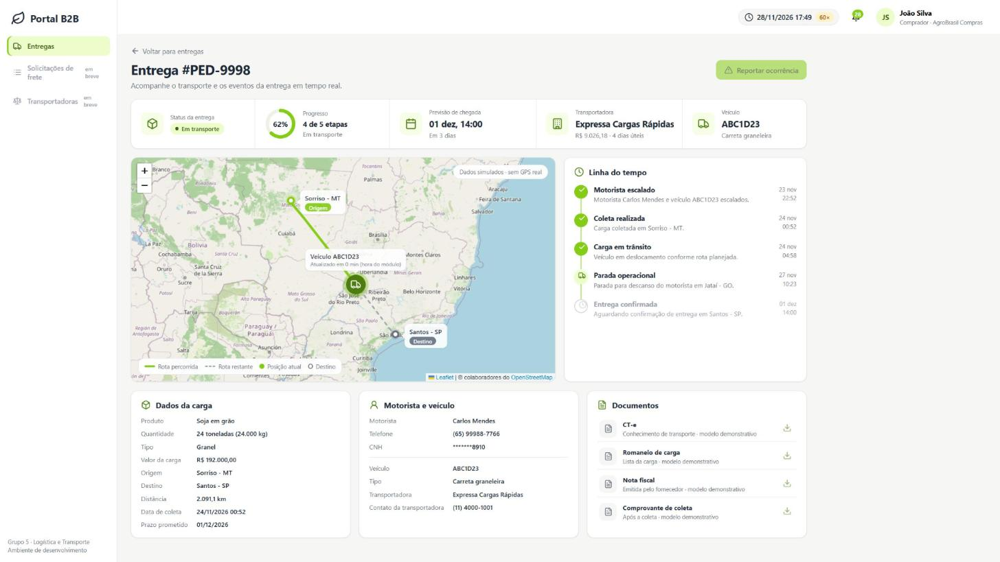
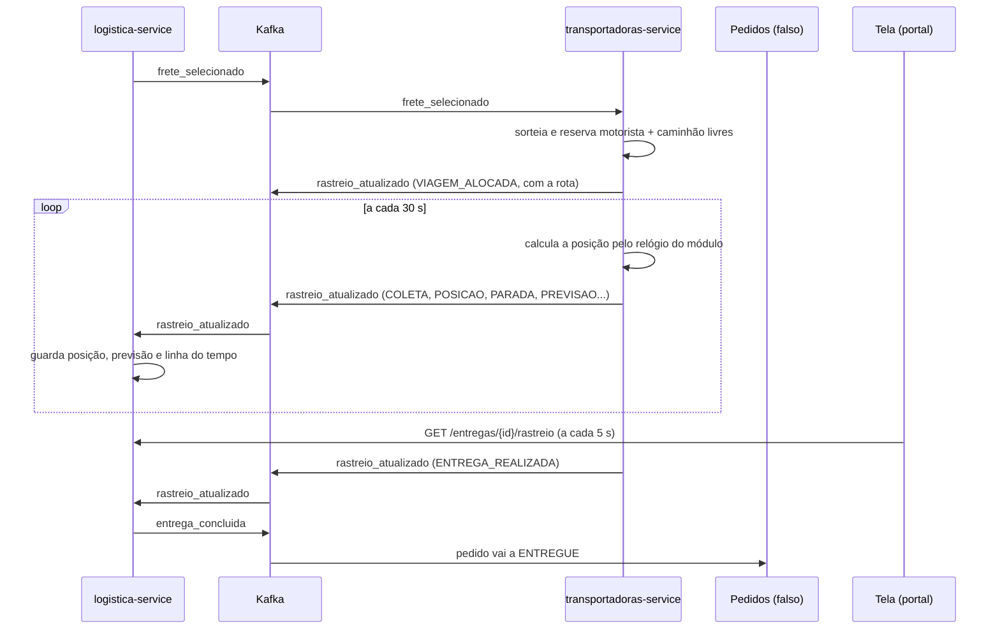

# 03. Rastreio visual: motoristas, viagem simulada e mapa

Etapa 3 do [plano](../05-plano-de-trabalho.md). Continua a [explicação 02](02-escolha-relogio-notificacoes.md).



## 1. O que esta parte faz

Depois que o frete é escolhido, o caminhão aparece andando no mapa até chegar:



| Parte | O que faz |
|---|---|
| Cadastro de frota | API para a transportadora cadastrar, alterar e desativar motoristas e veículos |
| Cotação | Uma transportadora só cota se tiver motorista e caminhão livres e compatíveis com a carga (D20) |
| Escala | Ao vencer, o sistema sorteia e reserva um motorista e um caminhão. Sem frota livre, a viagem é recusada e o frete passa para a próxima cotação |
| Viagem | Simulada: coleta, posição, parada para descanso, atraso (às vezes) e entrega |
| Entrega | A logística guarda tudo, publica `entrega_concluida` e conta a pontualidade da transportadora |
| Cancelamento | Pedido cancelado no meio da viagem: a viagem para e o caminhão e o motorista ficam livres |
| Telas | Portal em <http://localhost:8088>: lista de entregas e rastreamento com mapa, no layout do mockup do UX |

## 2. Onde está cada coisa

| Arquivo | O que tem |
|---|---|
| `services/transportadoras-service/transportadoras/simulacao.py` | A matemática da viagem: plano, progresso, parada, atraso, prazo. Sem banco, com testes |
| `services/transportadoras-service/transportadoras/servico.py` | Escala (`escalar`), reserva da frota, passos da viagem (`avancar_viagens`), cancelamento |
| `services/transportadoras-service/transportadoras/api.py` | Cadastro de motoristas e veículos |
| `services/transportadoras-service/migracoes/002_*.sql` | Tabelas `motorista`, `veiculo` e `viagem` |
| `services/transportadoras-service/migracoes/901_*.sql` | Frota de exemplo: 2 motoristas e 2 caminhões por transportadora (dados fictícios) |
| `services/logistica-service/logistica/rastreio.py` | Aplica cada evento de rastreio na entrega |
| `services/logistica-service/logistica/servico.py` | `trocar_transportadora`, quando a viagem é recusada |
| `services/logistica-service/logistica/api.py` | Rotas `/entregas`, `/entregas/{id}/rastreio`, `/pedidos/{id}/entrega` |
| `frontend/` | As telas (HTML, CSS e JavaScript, com o mapa Leaflet) |
| `infra/portal/` | O Nginx que serve as telas e reparte as chamadas entre as duas cópias de cada serviço |
| `comum/comum/ferramentas/usuarios_falso.py` | Login de demonstração das telas (só desenvolvimento) |

## 3. As ideias principais

### 3.1 A posição sai do relógio, não de um GPS

Não existe caminhão de verdade. Quando a transportadora é escalada, o sistema monta um **plano**:

| Item | Como é calculado |
|---|---|
| Coleta | 2 h depois da escala |
| Chegada | 14h da data que a transportadora prometeu na cotação (ela planeja chegar no dia combinado), mas nunca antes do tempo mínimo de estrada |
| Atraso | Sorteado uma vez, conforme a "probabilidade de atraso" da transportadora (a Econômica atrasa 35% das vezes, a Expressa 5%). Só aparece quando o caminhão passa de 60% do caminho |
| Parada | Uma parada para descanso aos 45% do caminho, na cidade mais próxima |

A cada 30 segundos, o sistema calcula **onde o caminhão deveria estar agora**, pela hora do módulo: se já passou metade do tempo entre a coleta e a chegada, ele está na metade da rota. Por isso acelerar o relógio acelera a viagem sem mudar nada no código.

### 3.2 O caminhão nunca volta para trás

Quando o atraso aparece, a chegada fica mais tarde. Se o progresso fosse sempre "tempo passado ÷ tempo total", aumentar o tempo total faria o progresso **diminuir**, e o caminhão voltaria no mapa. Para evitar isso, o cálculo parte de um **marco**: no momento do atraso, o sistema anota "estou em 62%, agora" e, dali em diante, anda de 62% até 100% no tempo que sobrou.

Do lado da logística há uma segunda proteção: cada evento tem um número de **sequência**, e um evento com número menor ou igual ao último aplicado é ignorado. Uma mensagem repetida ou atrasada nunca move o caminhão.

### 3.3 O mesmo caminhão nunca fica em duas viagens

Os dois serviços rodam em duas cópias, e dois fretes da mesma transportadora podem ser escolhidos ao mesmo tempo. A reserva do caminhão é uma **gravação condicional**:

```sql
UPDATE transportadoras.veiculo SET viagem_atual_id = :viagem
 WHERE id = :veiculo AND viagem_atual_id IS NULL
```

Só a primeira gravação encontra o caminhão livre e altera 1 linha. A segunda altera 0 linhas e tenta o próximo caminhão do sorteio. É o mesmo truque da escolha do frete ([explicação 01](01-base-e-fluxo-automatico.md), seção 3.6).

**Problema encontrado e corrigido:** a primeira versão travava **todos** os caminhões livres da transportadora enquanto escolhia um. Se duas viagens chegassem juntas, a segunda encontrava tudo travado e era recusada, mesmo sobrando caminhão. Com a gravação condicional, só o caminhão escolhido é disputado.

### 3.4 Quando a transportadora não tem caminhão

| Momento | O que acontece |
|---|---|
| Ao cotar | Sem par motorista + caminhão livre e compatível, a transportadora nem cota |
| Ao ser escolhida | Se o caminhão foi ocupado entre a cotação e a escolha, ela publica `VIAGEM_RECUSADA`. A logística passa para a próxima cotação pela regra do menor preço, cria uma nova entrega (`tentativa` 2), publica outro `frete_selecionado` e avisa comprador e fornecedor |
| Sem cotação restante | O frete fica indisponível e o pedido é cancelado (`frete_indisponivel`) |

### 3.5 Dados pessoais do motorista (LGPD)

A CNH completa fica só no serviço de transportadoras. Para a logística e para a tela vai só a versão mascarada (`*******8910`). Telefone e CNH só aparecem para o comprador e o fornecedor daquela entrega; uma transportadora ou outra empresa não conseguem ler a entrega.

### 3.6 A tela

- **Lista de entregas** (`index.html`): pedido, rota, transportadora, status, progresso e previsão. Atualiza a cada 5 s.
- **Rastreamento** (`entrega.html?id=...`): resumo (status, progresso, previsão, transportadora, veículo), mapa com rota percorrida (verde) e restante (tracejada), linha do tempo, dados da carga, motorista e documentos. Atualiza a cada 5 s.
- **Topo**: hora do módulo (o administrador escolhe 1×, 360× ou 3600×), sino com as notificações e troca de usuário.
- **Login**: na demonstração, escolhe-se um usuário pronto (comprador, fornecedor, transportadora ou administrador). No portal real, o login é do grupo de Autenticação.
- Os documentos aparecem desabilitados: os modelos demonstrativos (D21) entram na etapa 4.

Se o mapa não carregar (sem internet, por exemplo), a tela mostra origem, destino e a última posição em texto.

### 3.7 O portal faz o papel do gateway

O contêiner `portal` (Nginx) serve as telas e repassa as chamadas `/api/v1/...` para as duas cópias de cada serviço, como o gateway do kit. Se uma cópia cair, ele manda a requisição para a outra.

## 4. Como ver funcionando

```bash
docker compose up -d --build
docker compose exec logistica-1 python -m comum.ferramentas.publicar_pedido_falso --pedido-id PED-DEMO
```

1. Abra <http://localhost:8088> e entre como **João Silva (comprador)**.
2. Em <http://localhost:8108/docs>, com o token do comprador (`gerar_token --perfil comprador --empresa emp-comprador-1`), escolha uma cotação do PED-DEMO em `POST /solicitacoes/{id}/selecionar-frete`. A tela de comparação entra na etapa 4.
3. Volte ao portal: a entrega aparece em **Entregas**. Abra e acompanhe.
4. Troque para o **Administrador** (menu do usuário) e clique em **3600×** no relógio: a viagem de vários dias passa em poucos minutos. Volte para **1×** no fim.

Para o caminhão andar mais vezes durante a demonstração, suba com `RASTREIO_INTERVALO_SEGUNDOS=5` no `.env` (o padrão é 30 s, D10).

## 5. O que foi testado no ambiente rodando

49 verificações, todas passando, com o caminhão andando a cada 3 s e o relógio a 10.000×:

| Grupo | Verificações |
|---|---|
| Cadastro de frota | Transportadora lista a própria frota; outra transportadora → 403; comprador → 403; cadastra veículo → 201; placa repetida → 409; placa inválida → 422; desativa veículo livre; veículo em viagem não pode ser desativado → 409 |
| Cotação só com frota livre | Sem caminhão, a Expressa não cotou (2 cotações em vez de 3) |
| Recusa e troca | Econômica sem caminhão recusou; o frete passou para a Graneleira (tentativa 2); a tentativa 1 ficou `RECUSADA`; comprador avisado |
| Concorrência na escala | 3 escolhas simultâneas da Expressa, que tem 2 caminhões: 2 ficaram com ela, com caminhões e motoristas diferentes; a terceira foi trocada de transportadora |
| LGPD | CNH mascarada; fornecedor vê a entrega; perfil transportadora → 403 |
| Cancelamento | Entrega e viagem `CANCELADA`; motorista e caminhão liberados |
| Viagem completa | Rota de 60 pontos; entrega concluída; o caminhão nunca voltou (68 leituras); linha do tempo completa (27 eventos), sem buracos nem repetição; `entrega_concluida` publicado uma vez |
| Uma cópia caindo | `logistica-1` derrubada no meio da viagem: a tela continuou respondendo pela `logistica-2` e nenhum evento se perdeu |
| Fim | Todas as viagens terminaram; toda a frota livre; pontualidade registrada; fornecedor avisado; o Pedidos falso recebeu `ENTREGUE`; nada na DLT |

Mais 18 testes unitários novos (17 da simulação, em `tests/test_simulacao.py`, e 1 da rota, em `comum/tests/test_geo.py`), entre eles: o caminhão nunca volta quando o atraso aparece; com o relógio muito acelerado, parada, atraso e entrega saem na ordem certa num passo só; prazo até 23h59 de Brasília.

## 6. Perguntas que o professor pode fazer

**O rastreio é de verdade?**
Não: a posição é simulada, e a tela avisa "dados simulados". O sistema calcula onde o caminhão deveria estar pela hora do módulo. O que é de verdade é o caminho da informação: a transportadora publica eventos no Kafka, a logística consome, guarda e a tela consulta, igual seria com um GPS.

**Por que a tela pergunta a cada 5 s em vez de receber a posição na hora?**
Porque cada serviço roda em duas cópias e o evento de rastreio chega a só uma delas, mas a tela pode estar ligada à outra. Lendo do banco, as duas cópias respondem a mesma coisa. Receber "na hora" (SSE ou WebSocket) exigiria repassar o evento entre as cópias.

**Como garantem que o mesmo caminhão não vai para duas viagens?**
A reserva é uma gravação que só funciona se o caminhão ainda estiver livre. Testamos com três escolhas simultâneas para uma transportadora com dois caminhões: cada caminhão foi para uma viagem e a terceira foi trocada de transportadora.

**E se o caminhão "voltar" no mapa por causa de uma mensagem repetida?**
Não volta: cada evento tem número de sequência e a logística ignora os antigos. Além disso, quando a previsão muda, o cálculo parte do ponto onde o caminhão já está.

**O que acontece se uma cópia do serviço cair no meio da viagem?**
O Kafka passa as partições dela para a outra cópia, e o Nginx manda as chamadas da tela para a outra cópia. Testamos derrubando a `logistica-1` no meio de uma viagem: a tela continuou, e a sequência de eventos não teve buraco nem repetição.

**E se a transportadora escolhida não tiver caminhão?**
Ela recusa, e a logística passa sozinha para a próxima cotação pela regra do menor preço, avisando comprador e fornecedor. Sem cotação restante, o frete fica indisponível e o pedido é cancelado.

**Como a pontualidade da transportadora é medida?**
Entrega até 23h59 (Brasília) da data prometida é "no prazo". A logística soma as entregas e as no prazo por transportadora; isso entra no desempate da regra automática e, na etapa 4, no ranking.

**Por que a CNH aparece com asteriscos?**
É dado pessoal (LGPD). Só o serviço de transportadoras guarda a CNH completa; a logística e a tela recebem só os 4 últimos dígitos.
