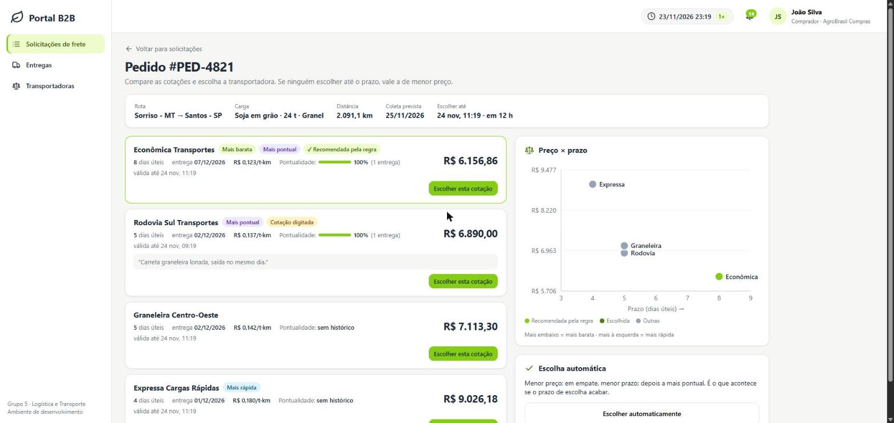
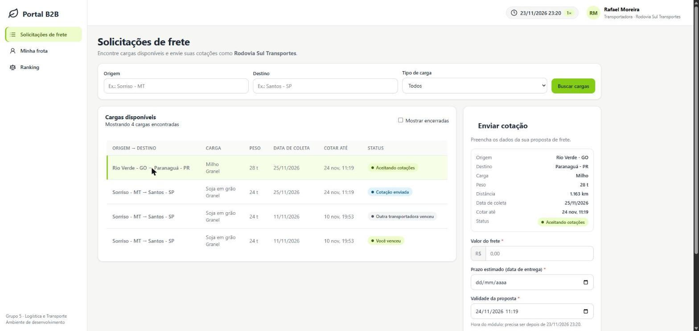

# 04. Comparação, cotação digitada, ranking, frota, documentos e ocorrências

Etapa 4 do [plano](../05-plano-de-trabalho.md). Continua a [explicação 03](03-rastreio-visual.md). Com ela, todas as telas do mockup do UX funcionam com dados reais.





## 1. O que esta parte faz

| Tela | Quem usa | O que faz |
|---|---|---|
| **Solicitações de frete** (`solicitacoes.html`) | comprador, fornecedor, admin | Lista os pedidos com a situação do frete e o prazo para escolher |
| **Comparação** (`comparacao.html`) | comprador (fornecedor e admin só veem) | Cotações lado a lado com selos, pontualidade e gráfico preço × prazo; escolha da cotação ou "automático" |
| **Solicitações de frete** (`fretes.html`) | transportadora | Cargas compatíveis com a frota e o painel "Enviar cotação" do mockup |
| **Minha frota** (`frota.html`) | transportadora | Cadastro e desativação de motoristas e veículos |
| **Ranking** (`transportadoras.html`) | todos | Entregas, % no prazo, atraso médio, preço médio por t·km e vezes escolhida |
| **Rastreamento** (já existia) | comprador, fornecedor, admin | Agora baixa os documentos em PDF e permite reportar ocorrência |

O menu muda conforme o perfil: a transportadora vê "Solicitações de frete", "Minha frota" e "Ranking"; os outros veem "Solicitações de frete", "Entregas" e "Transportadoras".

## 2. Onde está cada coisa

| Arquivo | O que tem |
|---|---|
| `services/logistica-service/logistica/regras.py` | `selos()` e `preco_por_tonelada_km()`: a lógica da comparação, sem banco, com testes |
| `services/logistica-service/logistica/documentos.py` | Os 4 PDFs demonstrativos (biblioteca `fpdf2`) |
| `services/logistica-service/logistica/api.py` | Rotas `/comparacao`, `/documentos/{tipo}`, `/ocorrencias` |
| `services/logistica-service/migracoes/004_ocorrencias.sql` | Tabela de ocorrências |
| `services/transportadoras-service/transportadoras/servico.py` | `cotar_manualmente`: as regras da cotação digitada |
| `services/transportadoras-service/transportadoras/api.py` | Rotas `/minha`, `/ranking`, `/solicitacoes` e `/solicitacoes/{id}/cotacoes` |
| `services/transportadoras-service/migracoes/003_*.sql` | Situação da solicitação vista pela transportadora e atraso real da viagem |
| `services/transportadoras-service/migracoes/902_*.sql` | A transportadora **real** de demonstração: Rodovia Sul Transportes |
| `frontend/` | As 5 páginas novas e as peças comuns (janela de confirmação, download do PDF) |

## 3. As ideias principais

### 3.1 Os selos da comparação

| Selo | Regra |
|---|---|
| Mais barata | Menor preço (empate: as duas ganham o selo) |
| Mais rápida | Menor prazo em dias úteis |
| Mais pontual | Maior % de entregas no prazo, entre as que já têm histórico |
| ✓ Recomendada pela regra | A que a regra automática escolheria agora: menor preço, depois menor prazo, depois mais pontual, depois o id |

O **preço por tonelada·km** (frete ÷ toneladas ÷ km) permite comparar o preço de cargas e rotas de tamanhos diferentes. A pontualidade que aparece na comparação vem da cópia que a logística guarda a cada entrega concluída; assim a tela não depende de chamar o serviço de transportadoras.

O **gráfico** coloca cada cotação num ponto: mais embaixo é mais barata, mais à esquerda é mais rápida. A melhor relação fica no canto de baixo à esquerda.

### 3.2 Transportadora simulada × transportadora real

| | Simulada (Expressa, Econômica...) | Real (Rodovia Sul) |
|---|---|---|
| Quem cota | O sistema, em segundos | Uma pessoa da transportadora, pela tela |
| Quando | Assim que a solicitação chega | Até o comprador escolher ou o prazo vencer |
| Como a cotação chega à logística | `cotacao_recebida` com `SIMULADA` | O mesmo evento, com `DIGITADA` |

Para a logística não há diferença: as duas chegam pelo mesmo tópico do Kafka. A diferença está só em quem cria a cotação.

### 3.3 Regras da cotação digitada

| Regra | Se não cumprir |
|---|---|
| A empresa do usuário tem uma transportadora compatível com a carga e a rota | 403 |
| A solicitação ainda está aberta | 409 `SOLICITACAO_ENCERRADA` |
| Uma cotação por transportadora | 409 `COTACAO_JA_ENVIADA` |
| Valor maior que zero; observação de até 500 caracteres | 422 |
| Entrega pelo menos um dia útil depois da coleta | 422 `PRAZO_INVALIDO` |
| Validade depois da hora atual do módulo | 422 `VALIDADE_INVALIDA` |
| Motorista e caminhão livres e compatíveis (D20) | 422 `SEM_FROTA_LIVRE` |

A tela confere as três primeiras validações de formulário antes de enviar (critério UX-FRT-06 do grupo de UX), mas quem decide é o serviço: a tela pode ser burlada, a API não.

**Como a transportadora sabe que perdeu ou ganhou?** O serviço de transportadoras consome `frete_selecionado`. Quando o evento chega, ele marca a solicitação como encerrada e anota quem venceu. Por isso a tela mostra "Você venceu" ou "Outra transportadora venceu" sem perguntar nada à logística. Se o pedido for cancelado (`pedido_atualizado`), a tela mostra "Pedido cancelado", inclusive para quem venceu (corrigido na [explicação 07](07-especificacoes-ers-llm.md)).

### 3.4 Escolher pela tela, com segurança

O botão "Escolher esta cotação" abre uma janela de confirmação com o resumo (transportadora, valor, prazo). Ao abrir a janela, a tela gera **uma** `Idempotency-Key`; se a internet falhar e a pessoa clicar de novo, vai a mesma chave, e o serviço devolve a mesma resposta em vez de tentar escolher de novo ([explicação 02](02-escolha-relogio-notificacoes.md), seção 3.2).

### 3.5 Documentos demonstrativos (D21)

O PDF é gerado na hora, com os dados reais da entrega, e não é guardado. Todo documento leva a marca d'água "DOCUMENTO DEMONSTRATIVO - SEM VALOR FISCAL", porque CT-e e nota fiscal de verdade são emitidos junto à SEFAZ.

| Documento | Conteúdo |
|---|---|
| CT-e | Transportadora, fornecedor, comprador, percurso, distância, valor do frete, prazo, carga, placa e motorista |
| Romaneio de carga | Carga, peso, percurso, coleta prevista, veículo, motorista e linha de assinatura |
| Nota fiscal | Fornecedor, comprador, produto, quantidade, valor e frete |
| Comprovante de coleta | Data e local da coleta, motorista (CNH mascarada), placa e duas assinaturas. Só existe depois da coleta (antes: 409) |

### 3.6 Ocorrências

O comprador ou o fornecedor descreve o problema; a ocorrência entra na linha do tempo do rastreio, a entrega fica marcada "com ocorrência" e **a outra parte do pedido é avisada** pelo sino.

### 3.7 Ranking

Calculado no serviço de transportadoras com os dados dele mesmo: viagens (entregas, no prazo, atraso real) e cotações emitidas (preço médio por t·km). Ordenado pela pontualidade; quem ainda não entregou nada fica no fim. Dá para filtrar por tipo de carga.

## 4. Como ver funcionando

```bash
docker compose up -d --build
docker compose exec logistica-1 python -m comum.ferramentas.publicar_pedido_falso --pedido-id PED-DEMO
```

1. Em <http://localhost:8088>, entre como **Rafael Moreira** (Rodovia Sul, transportadora real). Em "Solicitações de frete", clique na carga, preencha valor, data de entrega e validade e envie.
2. Troque para **João Silva** (comprador) pelo menu do usuário. Em "Solicitações de frete", abra o PED-DEMO: as 3 cotações simuladas e a digitada aparecem lado a lado, com selos e o gráfico. Escolha uma.
3. Clique em **Acompanhar a entrega**. Na tela de rastreamento, baixe o CT-e e reporte uma ocorrência.
4. Entre como **Maria Souza** (fornecedor): o sino mostra a ocorrência.
5. Como **Administrador**, acelere o relógio (3600×) até a entrega terminar e veja o **ranking**.
6. Como **Carla Expressa** ou **Rafael Moreira**, abra **Minha frota** e cadastre um motorista ou um veículo.

Para recomeçar do zero: `docker compose down -v && docker compose up -d --build` (necessário também quando há migração nova).

## 5. O que foi testado no ambiente rodando

65 verificações pelo portal, todas passando:

| Grupo | Verificações |
|---|---|
| Cotação digitada | A Rodovia não cota sozinha; vê a carga aceitando cotações; valor 0, entrega no dia da coleta, validade no passado e observação longa são recusados; cotação válida chega na logística como `DIGITADA`; segunda cotação → 409; a Expressa (que já cotou sozinha) → 409 |
| Comparação | Selos certos (a Rodovia, mais barata, ficou recomendada; a Expressa, mais rápida); preço por t·km; o comprador pode escolher; o fornecedor só vê; o admin vê |
| Escolha pela tela | O comprador escolhe a cotação digitada; a Rodovia vê "Você venceu"; a solicitação não aceita mais cotação; a frota da Rodovia é escalada |
| Perdeu e incompatível | Em outro pedido, a Rodovia vê "Outra transportadora venceu"; não vê carga refrigerada; cotar carga incompatível → 403; comprador na tela da transportadora → 403 |
| Documentos | CT-e, romaneio e nota fiscal em PDF; comprovante antes da coleta → 409 e depois → PDF; transportadora → 403; tipo desconhecido → 422 |
| Ocorrências | Descrição curta → 422; comprador reporta → 201; transportadora → 403; fornecedor avisado; aparece no rastreio; entrega marcada |
| Ranking | Conta a entrega e as 2 cotações da Rodovia; ordenado pela pontualidade; filtro por tipo de carga |
| Frota e telas | Cadastro de motorista; CNH repetida → 409; as 7 páginas no ar; nada na DLT |

Mais 19 testes unitários novos: selos e preço por t·km, os 4 PDFs, a situação da carga para a transportadora e o cálculo de dias úteis entre datas.

## 6. Perguntas que o professor pode fazer

**Como vocês compararam as transportadoras?**
De duas formas. Na solicitação: preço, prazo, preço por t·km e pontualidade lado a lado, com selos e um gráfico preço × prazo. No geral: um ranking com entregas, % no prazo, atraso médio e preço médio, calculado a partir das entregas feitas no portal.

**O que é a "transportadora real" se tudo é simulado?**
É uma transportadora que não cota sozinha: alguém da empresa precisa entrar no portal e digitar a cotação. Os caminhões andam pelo mesmo simulador, mas a cotação é decisão humana, como seria com uma transportadora de verdade.

**A cotação digitada passa por outro caminho até a logística?**
Não. Ela vira o mesmo evento `cotacao_recebida` das simuladas, só com `origemCotacao: DIGITADA`. Para a logística, uma cotação é uma cotação.

**Como a transportadora sabe que perdeu, se ela não lê o banco da logística?**
Pelo evento `frete_selecionado`, que diz qual transportadora venceu. O serviço de transportadoras consome esse evento e marca a solicitação como encerrada, anotando a vencedora.

**Os documentos têm valor?**
Não. São modelos com os dados reais da entrega e a marca "sem valor fiscal". CT-e e nota fiscal de verdade são emitidos pela transportadora e pelo fornecedor junto à SEFAZ, o que está fora do escopo do portal.

**Por que validar na tela e de novo no serviço?**
Na tela, para o usuário corrigir o erro antes de enviar. No serviço, porque qualquer um pode chamar a API sem passar pela tela; a regra que vale é a do serviço.

**Por que a comparação usa a cópia da pontualidade que fica na logística, e não pergunta ao serviço de transportadoras?**
Porque pela regra do kit um serviço não lê o banco do outro, e uma chamada HTTP deixaria a tela da logística dependente do outro serviço estar no ar. A logística atualiza a sua cópia a cada entrega concluída, que ela mesma acompanha.
